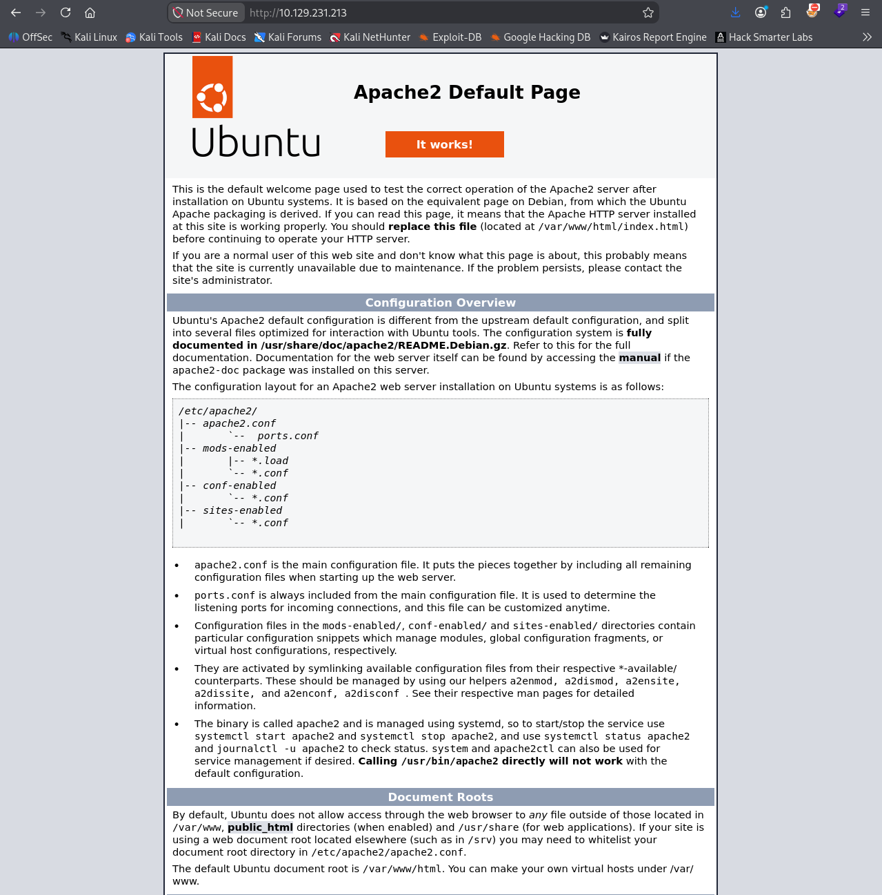
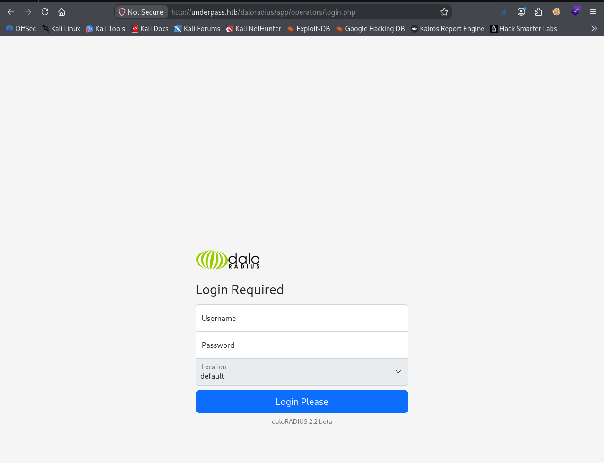
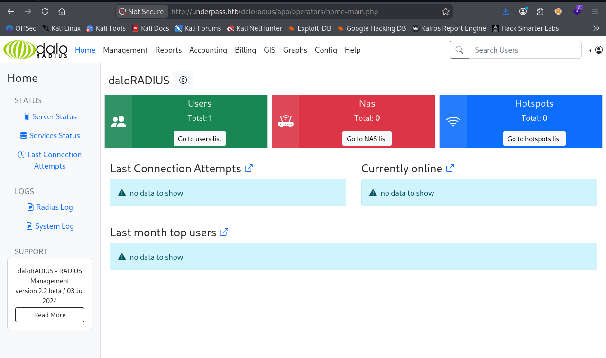

<p align="center">
  
</p>

# underpass - hack the box

**platform:** Hack The Box · retired machine  
**os:** Linux (Ubuntu 22.04.5 LTS)  
**outcome:** SSH as `svcMosh`, Linux root  
**focus:** UDP enumeration · SNMP · daloRADIUS · John the Ripper · password reuse · sudo · Mosh

---

## `00 \ prep`
---

prepped engagement structure; fish for environment variables and tmux for logging

```shell
CPTS/CPTS-Day04/underpass
❯ touch env.fish && mkdir loot logs notes scans

CPTS/CPTS-Day04/underpass
❯ cat env.fish
# Engagement configuration
set -gx ENGAGEMENT "underpass"
set -gx IP "<TARGET_IP>"

# New logging destination
set -gx ENGAGEMENT_DIR (pwd -P)

# Copy to tmux session
if set -q TMUX
    set -l session (tmux display-message -p '#S')

    tmux set-environment -t "$session" ENGAGEMENT "$ENGAGEMENT"
    tmux set-environment -t "$session" IP "$IP"
    tmux set-environment -t "$session" ENGAGEMENT_DIR "$ENGAGEMENT_DIR"
end

CPTS/CPTS-Day04/underpass
❯ source ./env.fish

CPTS/CPTS-Day04/underpass
❯ tree
.
├── env.fish
├── logs
│   └── tmux
│       ├── s0-p0-20261114T142907-zlTpqG.log
│       └── s0-p16-20261114T142907-LF36dq.log
├── loot
├── notes
│   └── notes.md
└── scans

6 directories, 4 files
```

---

## `01 \ recon`
---

### service discovery

began with the usual nmap scan of the top ports.

```console
❯ nmap -sVC -oA scans/initial $IP
Host is up (0.045s latency).
Not shown: 998 closed tcp ports (reset)

PORT   STATE SERVICE VERSION
22/tcp open  ssh     OpenSSH 8.9p1 Ubuntu 3ubuntu0.10 (Ubuntu Linux; protocol 2.0)
80/tcp open  http    Apache httpd 2.4.52 ((Ubuntu))
|_http-server-header: Apache/2.4.52 (Ubuntu)
|_http-title: Apache2 Ubuntu Default Page: It works
Service Info: OS: Linux; CPE: cpe:/o:linux:linux_kernel

Nmap done: 1 IP address (1 host up) scanned in 9.71 seconds
```

ran a full TCP port scan to see if there was anything else

```console
❯ nmap -p- --min-rate 1000 -oA scans/allports $IP
Host is up (0.045s latency).
Not shown: 65533 closed tcp ports (reset)

PORT   STATE SERVICE
22/tcp open  ssh
80/tcp open  http

Nmap done: 1 IP address (1 host up) scanned in 61.28 seconds
```

same two ports. the webserver didn't appear to have much on it either, just the default Apache page.



```console
❯ whatweb http://$IP
[200 OK] Apache[2.4.52], HTTPServer[Ubuntu Linux][Apache/2.4.52 (Ubuntu)], Title[Apache2 Ubuntu Default Page: It works]
```

### udp enumeration

with only two TCP ports and a default page, I decided to check UDP. this time things got a little more interesting.

```console
❯ nmap -sUV --top-ports 100 -oA scans/udp $IP
Host is up (0.047s latency).
Not shown: 96 closed udp ports (port-unreach)

PORT     STATE         SERVICE VERSION
68/udp   open|filtered dhcpc
161/udp  open          snmp    SNMPv1 server; net-snmp SNMPv3 server
1812/udp open|filtered radius
1813/udp open|filtered radacct

Nmap done: 1 IP address (1 host up) scanned in 211.01 seconds
```

| port | service | observation |
|---|---|---|
| 22/tcp | SSH | OpenSSH 8.9p1 |
| 80/tcp | HTTP | Apache 2.4.52 |
| 68/udp | DHCP client | open/filtered |
| 161/udp | SNMP | confirmed open |
| 1812/udp | RADIUS | open/filtered |
| 1813/udp | RADIUS accounting | open/filtered |

the RADIUS ports were only open/filtered, but SNMP was definitely giving me a response

### snmp enumeration

initially tried SNMPv3 and got an error.

```text
snmpwalk: No securityName specified
```

v3 and v2c don't authenticate the same way. my follow-up query returned system information, including the hostname, kernel and a pretty obvious hint about the application

```text
iso.3.6.1.2.1.1.1.0 = STRING: "Linux underpass 5.15.0-126-generic #136-Ubuntu SMP Wed Nov 6 10:38:22 UTC 2024 x86_64"
iso.3.6.1.2.1.1.6.0 = STRING: "Nevada, U.S.A. but not Vegas"
```

SNMP identified the machine as a daloRADIUS server. at least now I had something more specific to look for than the Apache default page

---

## `02 \ web enumeration`
---

### daloradius

daloRADIUS is the web interface for managing RADIUS. began looking into the application and its directory structure, rather than just enumerating the webserver blind

some of the directories returned by ffuf

```text
app                     [Status: 301]
library                 [Status: 301]
doc                     [Status: 301]
contrib                 [Status: 301]
setup                   [Status: 301]
```

looked through the daloRADIUS github repository to get a better idea of the application layout.

```console
daloradius on  master
❯ tree -L 3
.
├── AGENTS.md
├── app
│   ├── common
│   ├── operators
│   └── users
├── ChangeLog.md
├── contrib
│   ├── db
│   └── docker
├── doc
│   ├── install
│   └── setup
├── Dockerfile
├── README.md
└── setup
    └── install.sh

36 directories, 250 files
```

used the application structure to locate the login endpoint



spent some time looking through the install documentation. the web application has separate operators and users interfaces, and talks to the same database as FreeRADIUS

```text
doc/install/INSTALL.debian.md
249:export DALORADIUS_USERS_PORT=80
252:export DALORADIUS_OPERATORS_PORT=8000
```

spent way more time on this than I needed to. went looking through the source code and documentation trying to figure out the application before going back to basic authentication checks. default creds ftw




---

## `03 \ initial access`
---

### authenticated enumeration

eventually got into the daloRADIUS interface using default credentials. the dashboard confirmed version 2.2 beta, dated 03 Jul 2024

there was only one user listed on the dashboard. looking at the account details exposed its password hash

*Screenshot retained privately because it contains a password hash.*

### offline password recovery

used John the Ripper to check the hash. the format was raw MD5, so it didn't take much time at all

```text
Loaded 1 password hash (Raw-MD5 [MD5 256/256 AVX2 8x3])
1g 0:00:00:00 DONE
Session completed
```


the password was reused for the Linux account. verified SSH access as `svcMosh`

```text
Welcome to Ubuntu 22.04.5 LTS (GNU/Linux 5.15.0-126-generic x86_64)

svcMosh@underpass:~$
```

initial access

---

## `04 \ privilege escalation`

### local enumeration

ran the usual sudo check. there was a passwordless sudo permission for Mosh's server binary.

```text
User svcMosh may run the following commands on localhost:
    [passwordless permission for Mosh server]
```

wasn't particularly familiar with Mosh, so started looking into what it actually did. made the mistake of trying to cat the binary and got a screen full of garbage. `file` was a little more useful

```console
svcMosh@underpass:~$ file /usr/bin/mosh-server
/usr/bin/mosh-server: ELF 64-bit LSB pie executable, x86-64, version 1 (SYSV), dynamically linked, interpreter /lib64/ld-linux-x86-64.so.2, BuildID[sha1]=26b56b88e14ea6edca803fb0309a81ed06a7e970, for GNU/Linux 3.2.0, stripped
```

### mosh

went through the program help and man page. it's a remote terminal application intended to handle unreliable networks a little better than a conventional SSH session

```text
mosh-server (mosh 1.3.2) [build mosh 1.3.2]
```

the version was 1.3.2. initially tried `-v` thinking it would return version info, but it interpreted the argument as an IP address. interestingly, it still started a session and detached

```text
Error binding to IP -v: Bad IP address (-v): Name or service not known: Success
mosh-server (mosh 1.3.2) [build mosh 1.3.2]
[mosh-server detached, pid = 2897]
```

Mosh is split into a server and client. the server starts a terminal session and returns connection information for the client. its terminal traffic is carried over UDP, rather than the TCP connection used by SSH.

the important part wasn't the version. it was the fact that an interactive terminal service could run under a privileged account because of the sudo configuration. the privileged server started successfully and detached as a separate process

```text
mosh-server (mosh 1.3.2) [build mosh 1.3.2]
[mosh-server detached, pid = 2906]
```

I initially thought I would need the client on Kali, but ended up using the client already installed on the box, connecting on the loopback. the resulting terminal session was running as root

verified root access rather than just relying on the server starting successfully.

```text
root@underpass:~# ls
root.txt
```

root.

---

## `05 \ findings and lessons`

### systems / methods / findings

| system | finding | impact |
|---|---|---|
| SNMP | legacy SNMP access | system and application information disclosure |
| daloRADIUS | default credentials | operator access |
| daloRADIUS | weak password storage and hash exposure | offline password recovery |
| Linux | password reuse | SSH access |
| sudo / Mosh | excessive permissions | root-level access |

### methodology

- dont forget udp
- pay attention to the service metadata. SNMP gave me a specific application to investigate
- try the basic authentication and configuration checks before spending hours in the source code
- understand what a program does and what user it runs as. not every privilege escalation requires a CVE

---

<sub>nu11s3c </sub>
