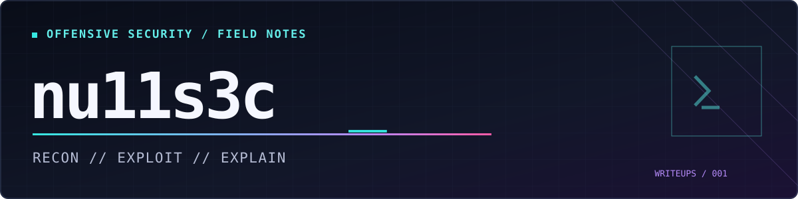

  

<h1 align="center">nu11s3c / writeups</h1>

  <strong>Retired machines · Practical methodology · Lessons learned</strong> 
  Recon first. Assumptions second. Screenshots only when they prove something.

  <kbd>WINDOWS</kbd> &nbsp; <kbd>LINUX</kbd> &nbsp; <kbd>NETWORK</kbd> &nbsp; <kbd>WEB</kbd> &nbsp; <kbd>ACTIVE DIRECTORY</kbd>

---

## `01 / About this repository`

A public record of my work on **authorized, publishable security labs**. Each writeup documents how I investigated a target, why I chose each next step, how I verified the result, and what I would improve next time.

The tone is technical, with occasional jokes and memes where they belong. The aim is to show my reasoning, not just a sequence of copied commands.

## `02 / Writeup index`

| Lab | Platform | Target | Main techniques | Stage |
|:---|:---|:---|:---|:---|
| [Access](machines/access.md) | Hack The Box · retired | Windows Server 2008 R2 | Anonymous FTP → file analysis → Telnet → stored credentials / DPAPI | **Published** |

## `03 / What you'll find in a writeup`

- **Recon:** What was exposed, and which observations changed my priorities?
- **Initial access:** What evidence connected the discovered artifacts to a foothold?
- **Privilege escalation:** What changed my security context, and how did I verify it?
- **Tradecraft:** Troubleshooting, false starts, and reusable techniques.
- **Lessons learned:** What I will recognize faster on the next assessment.

I favor a few relevant command outputs over walls of terminal noise. Flag values, raw loot, and reusable secrets are not included.

## `04 / Publication boundaries`

This public repository contains material from **retired or otherwise explicitly publishable labs only**. Active machines, protected Academy content, most Pro Labs, and examination/capstone solutions are not published. See the [HTB publication rules](https://help.hackthebox.com/en/articles/5188925-streaming-writeups-walkthrough-guidelines) before sharing a new article.

All work is limited to authorized systems. Writeups are for education and documentation, not authorization to test unrelated targets.

## `05 / Behind the scenes`

Working notes, screenshots, scan outputs, credential stores, and research remain **private and outside this repository**. Public writeups are curated from those notes after review and redaction. The [publishing checklist](PUBLISHING.md) describes the release process.

---

nu11s3c // understand the result, then explain the path

