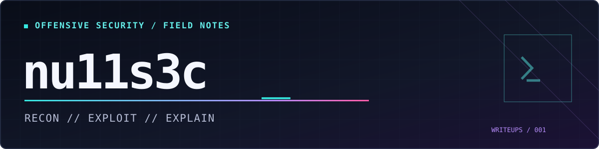

<p align="center">
  
</p>

# Access — Hack The Box

> [!IMPORTANT]
> **Author's writing outline — not a finished writeup.** Replace prompts with your own explanation before marking complete. No passwords, flags or raw loot should be published.

**Platform:** Hack The Box · retired machine  
**OS:** Windows Server 2008 R2 Standard, x64 (build 7600)  
**Outcome:** User foothold, user flag, elevated local Administrator execution and Administrator-level objective  
**Focus:** FTP troubleshooting · Microsoft Access database inspection · encrypted ZIP / PST · Telnet · Windows Credential Manager

**Navigation:** [Recon](#01--recon) · [Artifact analysis](#02--artifact-analysis) · [Initial access](#03--initial-access) · [Escalation](#04--privilege-escalation) · [Lessons](#05--lessons-learned)

---

## `00 / Overview`

**Write in your own voice:**
- [ ] In 2–4 sentences, introduce the target, scope and objective.
- [ ] Explain why this box was useful for practicing evidence-based CPTS methodology.
- [ ] Decide whether a restrained joke is useful at a real turning point.

**Source:** Your private Access CherryTree notebook and HTB completion record (not uploaded here).

## `01 / Recon`

### Initial service discovery

- [ ] Describe `nmap -sVC -oA scans/initial $IP`, including that the default scan covered 1,000 common TCP ports, not a full TCP range.
- [ ] Present the three discovered ports, their service versions, and the anonymous FTP result.
- [ ] Explain why FTP received priority, but why you kept Telnet and HTTP on your attack-surface list.
- [ ] Note the contrast between the external scan and later local SMB listeners; a listening socket isn't necessarily remotely reachable.

| Port | Service | Initial observation |
|---:|---|---|
| 21/tcp | Microsoft FTP | Anonymous login allowed; passive data connection failed |
| 23/tcp | Microsoft Telnet | Interactive login service |
| 80/tcp | Microsoft IIS 7.5 | MegaCorp web page |

**Evidence prompt:** Excerpt of `scans/initial.nmap` showing FTP `230` and `425`, and the other open ports.

### FTP — active versus passive mode

- [ ] Explain the FTP control/data channel distinction and why passive-mode failure did **not** contradict successful anonymous login.
- [ ] Describe your active-mode verification and the successful server-initiated data connection.
- [ ] Name both exposed directories, `Backups` and `Engineer`; explain which file types made them promising.
- [ ] Discuss the remote path and whitespace problems, and why re-downloading binary artifacts using binary mode mattered.

```bash
# Connection-mode validation
curl -v --ftp-port - "ftp://$IP/"
```

**Evidence prompt:** A concise listing showing `backup.mdb` and `Access Control.zip`. Avoid dumping the entire FTP transcript.

## `02 / Artifact analysis`

### Database triage

- [ ] Describe how `file` established the Microsoft Access database format.
- [ ] Explain why listing tables and inspecting schemas beats blindly dumping an unknown database.
- [ ] Identify relevant tables and their record counts: `auth_user` = 3; `SECURITYDETAILS` = 0; `USERINFO` = 5.
- [ ] Explain why `auth_user` was prioritized: username, password, status, role, last-login fields.
- [ ] Describe observing plaintext application credentials without putting their values in the public article.
- [ ] Separate confirmed plaintext storage from unverified assumptions about Windows credential validity.

```bash
file backup.mdb
mdb-tables -1 backup.mdb
mdb-schema -T auth_user backup.mdb
mdb-count backup.mdb auth_user
# Review CSV only in your private working directory.
mdb-export backup.mdb auth_user
```

**Evidence prompt:** The relevant `auth_user` schema and a redacted table excerpt with the password column replaced with `[REDACTED]`.

### Encrypted archive and Outlook mailbox

- [ ] Explain what `unzip`'s unsupported method `99` revealed about WinZip AES encryption.
- [ ] Show why an archive can expose its filenames even when file contents are encrypted.
- [ ] Write about the hypothesis connecting the engineer account and the protected ZIP, identifying what evidence supported testing it.
- [ ] Contrast `7z t` (test) with `7z x` (extract), including the earlier zero-byte PST and valid 271,360-byte extraction.
- [ ] Describe parsing the PST with `readpst`, discovering an `mbox`, and interpreting the plain-text/HTML MIME variants as **one** email.
- [ ] Summarize the email's relevant finding: a credential for the `security` account. Do not reproduce the plaintext password.

```bash
file 'Access Control.zip'
7z l -slt 'Access Control.zip'
7z t 'Access Control.zip'                   # password prompt
7z x 'Access Control.zip' -opst_extracted
readpst -r -o pst_mail 'Access Control.pst'
```

**Evidence prompt:** Sanitized ZIP metadata; email sender/subject/date and a redacted credential statement.

## `03 / Initial access`

- [ ] Explain why Telnet was a logical *targeted* validation point after the mailbox discovery.
- [ ] Document the successful login as `security` without including the password.
- [ ] Show the command prompt, `whoami` and the relevant portions of `whoami /groups`.
- [ ] Explain the meaning of `BUILTIN\\Users` and a medium-integrity token.
- [ ] Note that the user flag was retrieved, omitting its contents.
- [ ] Distinguish finding a credential from proving authentication and obtaining an interactive foothold.

```cmd
whoami
whoami /groups
whoami /priv
```

**Evidence prompt:** Redacted Telnet banner, account context, and a confirmation that the user's Desktop objective was found.

## `04 / Privilege escalation`

### Enumeration and decision-making

- [ ] Explain what `systeminfo` established about Windows Server 2008 R2 and patch information without asserting a kernel exploit.
- [ ] Mention the blocked `wmic product` command briefly as a genuine dead end.
- [ ] Explain why the ordinary `SeChangeNotifyPrivilege` and `SeIncreaseWorkingSetPrivilege` did not offer a strong escalation hypothesis.
- [ ] Describe the decisive result from `cmdkey /list`: stored `ACCESS\\Administrator` credential.

```cmd
cmdkey /list
```

### Credential Manager → elevated execution

- [ ] Explain the hypothesis behind `runas /savecred`.
- [ ] Describe executing a harmless identity check as a new process and redirecting its output to a file.
- [ ] Explain why the original Telnet session remained `security`.
- [ ] Walk through proof of escalation: `ACCESS\\Administrator`, RID `500`, enabled `BUILTIN\\Administrators`, and **High Mandatory Level**.
- [ ] Explain why privileges marked `Disabled` in an elevated token do not invalidate administrative execution.
- [ ] Describe listing the Administrator Desktop and accessing the final objective without sharing the flag contents.

```cmd
runas /savecred /user:ACCESS\Administrator "cmd /c whoami > C:\Users\security\Documents\admin-check.txt"
type C:\Users\security\Documents\admin-check.txt
```

**Evidence prompt:** `cmdkey /list`, `whoami /all` (selected lines), and redacted `root.txt` existence/access proof.

## `05 / Lessons learned`

**Prompts for your own technical reflection:**
- [ ] What would have happened if you trusted Nmap's passive FTP error and moved on?
- [ ] Why was file identification and schema triage more efficient than random guessing?
- [ ] How did the artifacts form a connected sequence of hypotheses rather than separate loot?
- [ ] Why was `cmdkey /list` more useful here than hunting speculative Windows kernel exploits?
- [ ] How did you establish **effective** admin rights, not just a different username?
- [ ] Which false start would make a worthwhile short joke or meme caption?
- [ ] What one additional step belongs on your next Windows enumeration checklist?

**TTPs:** Anonymous FTP · Active FTP · MDB Tools · WinZip AES · PST parsing · Telnet · Credential Manager · `runas /savecred` · Windows token inspection

## `06 / References`

- [HTB publication guidelines](https://help.hackthebox.com/en/articles/5188925-streaming-writeups-walkthrough-guidelines)
- [Microsoft — runas](https://learn.microsoft.com/en-us/previous-versions/windows/it-pro/windows-server-2012-r2-and-2012/cc771525(v=ws.11))
- [Microsoft — cmdkey](https://learn.microsoft.com/en-us/windows-server/administration/windows-commands/cmdkey)

---

<sub>nu11s3c // Retired lab; no flags, reusable credentials, or original loot published.</sub>
